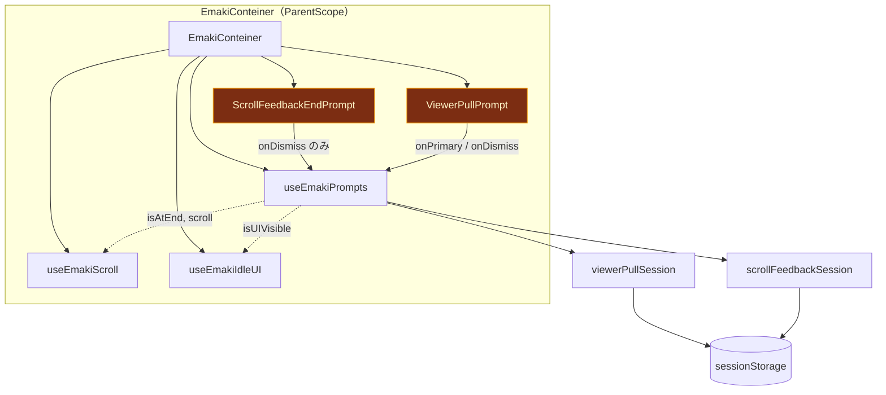
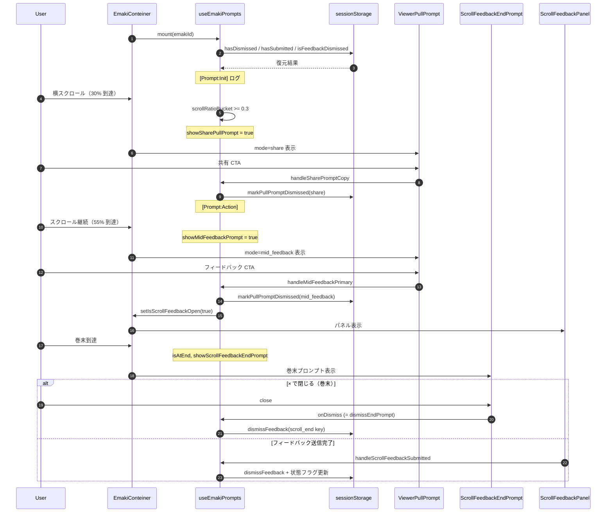

# 絵巻ビューア・プルプロンプト仕様（中盤 / 巻末）

中盤の `ViewerPullPrompt`（共有・中盤フィードバック）と巻末の `ScrollFeedbackEndPrompt` の責務境界とデータフローを定義する。現行挙動を維持し、自動消去タイマー等の UX 変更は本書のスコープ外とする。

## 1. 全体アーキテクチャと親子階層マップ

**警戒ゾーン（bugZone）:** 一度表示条件を満たすと、現行実装では自動消去タイマーがなく、ユーザーが × またはプライマリアクションを実行するまで UI が残留しうる。`dismiss` フラグと `sessionStorage` が同期されるまで再トリガーは抑止されるが、表示中の長時間滞留は既知の観測ポイントとする。

## 2. 外部・内部モジュールの責務一覧

| レイヤー | モジュール名 | 主要責務 | 入力（Data In） | 出力・作用（Data Out / Side Effect） |
|---------|-------------|---------|----------------|-------------------------------------|
| UI 親 | `EmakiConteiner.js` | プロンプトのマウント条件（`scroll`）、パネル `ScrollFeedbackPanel` の開閉 state 配線 | `data`, スクロール端点, `isUIVisible` | 子プロンプトへの props 渡し |
| フック | `useEmakiPrompts.js` | dismiss 状態・比率バケット・表示条件・ハンドラ・デバッグログ | `emakiId`, `articleRef`, `isAtEnd`, `isUIVisible`, `isScrollFeedbackOpen` | 真偽値 3 種 + ハンドラ群 |
| UI | `ViewerPullPrompt.js` | 共有 / 中盤 FB の文言・CTA・× 表示（presentation のみ） | `mode`, `isVisible`, `onPrimary`, `onDismiss` | クリックイベントを親へ委譲 |
| UI | `ScrollFeedbackEndPrompt.js` | 巻末の共有ボタン群・フィードバック導線・× | `emakiId`, `onDismiss`, `onOpenFeedback` | × は `onDismiss` のみ（永続化はフック側） |
| フック | `useEmakiScroll` | 横スクロール・端点 `isAtEnd` | `articleRef` | `isAtEnd` 更新 |
| フック | `useEmakiIdleUI` / AutoPlay 連携 | `isUIVisible`（無操作で UI 非表示） | ユーザーアクティビティ | プロンプト表示ゲート |
| 永続化 | `viewerPullSession.js` | 中盤プル dismiss（share / mid_feedback） | `emakiId`, `kind` | `sessionStorage` 読書 |
| 永続化 | `scrollFeedbackSession.js` | 巻末 FB 送信済み・巻末 dismiss | `emakiId`, feedback key | `sessionStorage` 読書 |

## 3. 動的データフロー（シーケンス図）

