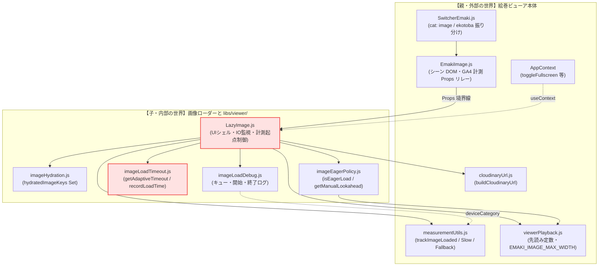
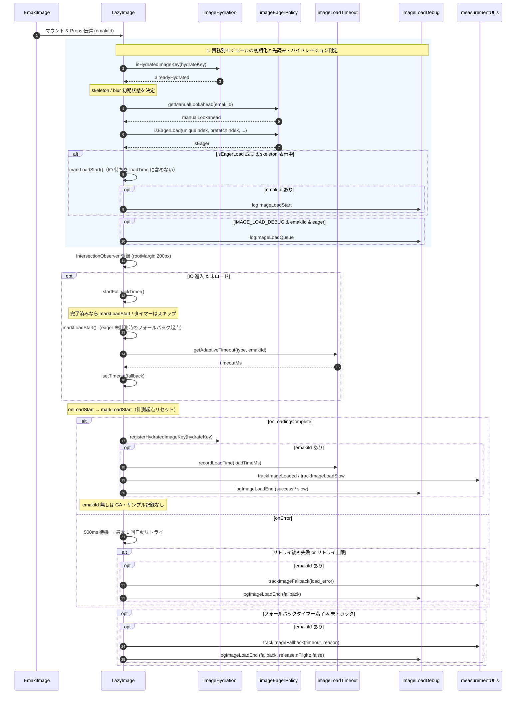

### 1. 全体アーキテクチャと親子階層マップ

本編・詞書シーンはいずれも `SwitcherEmaki` 経由で `EmakiImage` → `LazyImage` の単一経路に収束します。計測起点のずれは `LazyImage` と `imageLoadTimeout` の境界で過去に顕在化しています。

---

### 2. 外部・内部モジュールの責務一覧

| レイヤー | モジュール名 | 主要責務 | 入力（Data In） | 出力・作用（Data Out / Side Effect） |
| --- | --- | --- | --- | --- |
| 親 | `SwitcherEmaki.js` | ・`cat` に応じた section シェル（屏風・スポットピンは image のみ）  ・`EmakiImage` へ共通 Props 配線 | `cat`, `item`, `data`, `navIndex`, `isByobu` | `EmakiImage` マウント |
| 親 | `EmakiImage.js` | ・シーン DOM ラップ・`scrollDialog` ref 配線  ・`emakiId` を含む計測用 Props を `LazyImage` へリレー | `item`, `navIndex`, `sceneIndex`, `emakiId`, `isPlayMode`, `isByobu` | `LazyImage` マウント、GA4 サンプル対象（`emakiId` あり時） |
| 親 | `measurementUtils.js` | ・`getDeviceType`: 画面幅に加え `matchMedia("(pointer: coarse)")` または `navigator.maxTouchPoints > 0` でタッチ端末を検出し、**viewport が 1024px 以上でも tablet 扱い**（再生速度 tablet 向け **96px/s** 等の判定に使用）  ・GA4 画像ロード計測 API | viewport, pointer, touch | `getDeviceType()`, `trackImageLoaded` / `Slow` / `Fallback` |
| 子（UIシェル） | `LazyImage.js` | ・Next/Image + skeleton/blur 制御  ・`markLoadStart` による計測起点の一本化（eager / IO）  ・**`<Image>` の `onLoadStart` で計測開始時刻をリセット**（再試行・src 差し替え後も正しく計測）  ・**`onError` は即 `load_error` 確定せず 500ms 待機後に最大 1 回自動リトライ**  ・IntersectionObserver とフォールバックタイマー | `src`, `uniqueIndex`, `prefetchIndex`, `emakiId`, `isPlayMode`, AppContext | 画像表示、`registerHydratedImageKey`, GA4 イベント、デバッグログ |
| 子（タイムアウト） | `imageLoadTimeout.js` | ・直近ロード時間サンプルからアダプティブ閾値算出  ・接続種別・巻別倍率を合成 | `type`（priority/fullscreen/universal）, `emakiId`, `recordLoadTime(ms)` | `getAdaptiveTimeout` 戻り値（ms）、セッション内 `loadTimeSamples` 更新 |
| 子（先読み） | `imageEagerPolicy.js` | ・再生/全画面/手動先読み幅に応じた `loading=eager` 判定  ・`getManualLookahead`: **tablet / mobile**（`getDeviceType`）、**`navigator.connection.effectiveType` 未取得・`unknown`**（iOS Safari 等）、低速回線、鳥獣戯画第一巻のいずれかで先読み **1 枚**（`MANUAL_IMAGE_LOOKAHEAD_CONSTRAINED`） | `uniqueIndex`, `prefetchIndex`, `isPlayMode`, `toggleFullscreen`, `emakiId`, `manualLookahead` | `isEagerLoad` boolean、`getManualLookahead` 数値 |
| 子（ハイドレーション） | `imageHydration.js` | ・一度ロード完了したキーをモジュールスコープ Set で保持  ・描画窓 remount 時の blur/skeleton 再表示を抑止 | `hydrateKey`（`emakiId:uniqueIndex` または `src`） | `isHydratedImageKey`, `registerHydratedImageKey` |
| 子（デバッグ） | `imageLoadDebug.js` | ・in-flight / preload キューを集約ログ  ・開始・終了を統一フォーマットで console 出力（**本番: `DEBUG_IMAGE_LOAD` / `IMAGE_LOAD_DEBUG` は false**） | `IMAGE_LOAD_DEBUG`, 各ログ関数の引数 | `console.log`（`%c[timestamp][Tag]` 形式）、カウンタ更新 |

---

### 3. 動的データフロー（シーケンス図）

`EmakiImage` から `LazyImage` マウント後の、ハイドレーション・先読み・IO・完了計測までの時系列です。

---

### 4. 運用・仕様注記（方針①〜④）

- **タッチ端末の device 分類**: `getDeviceType` は幅 1024px 以上でも、タッチ（coarse pointer / `maxTouchPoints`）なら **tablet** とみなす。自動再生のスクロール速度は tablet 向け **96px/s** を適用する。
- **保守的先読み**: `getManualLookahead` は tablet・mobile、および Network Information API が使えない／`effectiveType === "unknown"` の環境で先読みを **1 枚**に制限し、同時接続飽和を避ける（`imageEagerPolicy.js` / `imageLoadTimeout.js` / `imageLoadDebug.js` の `DEBUG_IMAGE_LOAD` および `IMAGE_LOAD_DEBUG` は本番 **false**）。
- **計測・リトライ**: `LazyImage` はネットワーク再開ごとに `onLoadStart` で計測起点をリセットし、一過性エラーは **500ms 後 1 回**リトライしてから `load_error` を確定する。
