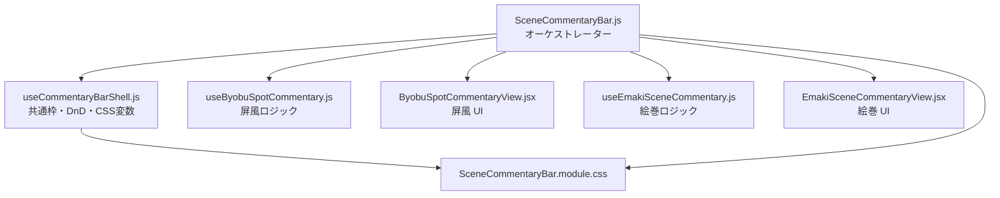
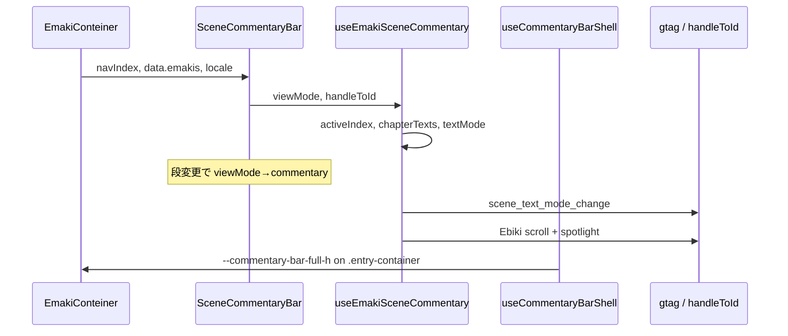
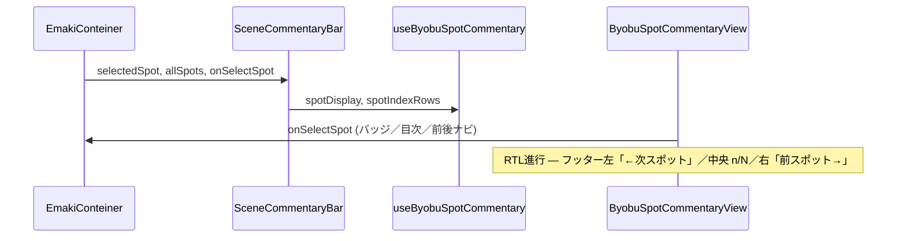

# SceneCommentaryBar 責務分離仕様（Clean-Arch & Safe-Delete v1.0 / Step 2）

## モジュール構成

## 責務一覧

| ファイル | 責務 |
|----------|------|
| `SceneCommentaryBar.js` | Props 不変の default export。ヘッダー（Like/Share）、共通カード枠、モード分岐、Folklore シート配置 |
| `useCommentaryBarShell.js` | `closed` / `expanded` / `viewMode` / `cardPos`、向き連動、フローティング DnD、Esc、`useCommentaryBarMetrics`（`--commentary-bar-full-h` / `--folklore-sheet-bottom`） |
| `useByobuSpotCommentary.js` | `isByobuSpotMode`、`activeByobuSpot*`、`spotIndexRows`、`spotDisplay`、`prevSpot` / `nextSpot`、`handleNavigateSpot` |
| `ByobuSpotCommentaryView.jsx` | スポット目次、カテゴリ行、未選択ガイド・詳細本文、前後スポット名付きナビ |
| `useEmakiSceneCommentary.js` | `?ebiki`、段インデックス、詞書タブ、絵引、探索、`handleNavigate` / `handleFolkloreSelect` |
| `EmakiSceneCommentaryView.jsx` | 段目次、絵引リスト、モードタブ、`CommentaryTextView` / `CommentaryExploreView` |

## データフロー — 絵巻モード

## データフロー — 屏風モード

## 屏風フッター前後ナビ（RTL）

横スクロール（右→左）の進行方向に合わせ、**左ボタンが「次へ」**（ラベル `← ${nextSpotTitle}`、末尾なら disabled で `← 次へ`）、**右ボタンが「前へ」**（`${prevSpotTitle} →`、先頭なら `前へ →`）。中央は `spotActiveIndex + 1 / N`。

## 段・スポット目次（`CommentarySectionIndex`）

絵巻・屏風共通。`SceneCommentaryBar.module.css` の `.sectionIndex` に `max-height: min(300px, 44vh)` と `overflow-y: auto` を設け、`.entry-container` 上端からはみ出さない。フルスクリーン（フローティングカード）時は `max-height: min(380px, 52vh)`。行はコンパクト（サムネ 40×28px、行 padding 6px 8px）。`activeIndex` 変更時は選択行へ `scrollIntoView({ block: "nearest" })`。

## 配色（カラーモード）

コメンタリーバー配下の配色は **`src/theme/colorMode.js`** 由来の CSS 変数（`--era-accent`, `--era-text`, `--era-soft-bg`, `--era-border`, `--bar-text`, `--bar-text-muted`）および親要素の `data-viewer-mode`（`emaki` / `byobu`）に従うこと。屏風スポット UI（`ByobuSpotCommentaryView.jsx`）の文字色は `var(--era-text)` / `var(--bar-text)` / `var(--bar-text-muted)` のみを参照し、フォールバック付き hex や標準リンク色を使わない。コンポーネント内に色コード（hex / rgb リテラル）をハードコードしない。

## 外部契約（DOM / CSS 変数）

| 種別 | 名前 | 設定元 | 意味 |
|------|------|--------|------|
| `data-*` | `data-viewer-mode` | `.entry-container` / `.wrap` | `resolveViewerMode(data)` |
| `data-*` | `data-orientation` | バー root | `AppContext.orientation` |
| `data-*` | `data-fullscreen` | wrap / bar | フローティングカード時 `"true"` |
| `data-*` | `data-expanded` | `.bar` | 本文展開 |
| `data-*` | `data-text-mode` | `.bar` | 現テキストモード（絵巻） |
| CSS 変数 | `--era-accent` / `--era-text` / `--era-soft-bg` / `--era-border` | `.entry-container`, `.wrap` | `buildViewerThemeStyle(data)` |
| CSS 変数 | `--commentary-bar-full-h` | `.entry-container` | バー実高さ（px） |
| CSS 変数 | `--folklore-sheet-bottom` | `.entry-container` | Folklore シート下端オフセット |
| イベント | `scene_modal_open` | 展開時 gtag | 仕様維持 |
| イベント | `scene_text_mode_change` | タブ切替 gtag | 仕様維持 |
| コールバック | `handleToId` | 絵引・段目次 | AppContext |
| コールバック | `onSelectSpot` / `onClearSelectedSpot` | 屏風スポット | EmakiConteiner |