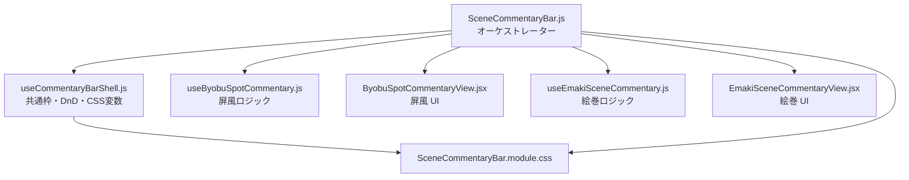
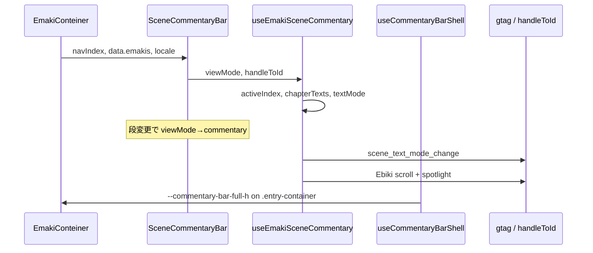
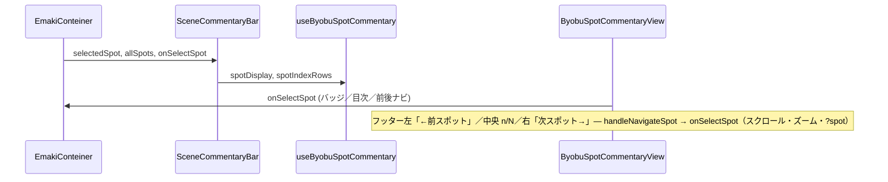

# SceneCommentaryBar 責務分離仕様（Clean-Arch & Safe-Delete v1.0 / Step 2）

## モジュール構成

## 責務一覧

| ファイル | 責務 |
|----------|------|
| `SceneCommentaryBar.js` | Props 不変の default export。ヘッダー（Like/Share）、共通カード枠、モード分岐、Folklore シート配置 |
| `useCommentaryBarShell.js` | `closed` / `expanded` / `viewMode` / `cardPos`、向き連動、フローティング DnD、Esc、`useCommentaryBarMetrics`（`--commentary-bar-full-h` / `--folklore-sheet-bottom`） |
| `useByobuSpotCommentary.js` | `isByobuSpotMode`、`activeByobuSpot*`、`spotLikeSceneIndex`（`1000 + index`）、`spotIndexRows`、`spotDisplay`、`prevSpot` / `nextSpot`、`handleNavigateSpot`、`crossEditionLinks` / `hubComparisonLink`（解説文・カテゴリは下記2層フォールバック） |
| `ByobuSpotCommentaryView.jsx` | スポット目次、カテゴリ行、未選択ガイド・詳細本文、他伝本ワープ＋比較ハブ（`#motif-<masterId>`）の1行ピルチップ、前後スポット名付きナビ |
| `useEmakiSceneCommentary.js` | `?ebiki`、段インデックス、詞書タブ、絵引、探索、`handleNavigate` / `handleFolkloreSelect` |
| `EmakiSceneCommentaryView.jsx` | 段目次、絵引リスト、モードタブ、`CommentaryTextView` / `CommentaryExploreView` |

## データフロー — 絵巻モード

## データフロー — 屏風モード

## 屏風スポット — カテゴリ・解説本文（2層フォールバック）

`useByobuSpotCommentary.js` の `spotDisplay` / `spotIndexRows` は次の優先順でカテゴリ・解説を解決する。**相互リンクチップ**（`crossEditionLinks` / `hubComparisonLink`）はこの解決とは独立し、引き続き `rakuchuMotifMaster.js`（`isCrossLinkableMaster`）のみを正本とする。

| 種別 | 第1優先（作品メタデータ `spots[]`） | 第2優先（共通マスター） | 欠落時 |
|------|-------------------------------------|-------------------------|--------|
| カテゴリ | `category` / `categoryen`（ロケールに応じて相互フォールバック） | `master.category` → 日本語は `BYOBU_CATEGORY_JA` マップ | `null` |
| 解説本文 | `summary` / `summaryen` / `description` / `descriptionen`（ロケール順） | `master.summaryJa` / `master.summaryEn` | `""`（`stripHtml` 後も安全） |

## 屏風スポット詳細 — 他伝本・比較ハブ（インラインピル1行）

選択スポットの解説本文直下に、1行のピル型チップ行を表示する（`flex-wrap`、gap 6px）。展開用 `.body` の `<button>` 内に置くため、チップは **`<Link>` のみ**（`stopPropagation`）— `<button>` ネスト禁止。

| チップ | 条件 | スタイル | 遷移先 |
|--------|------|----------|--------|
| 他伝本ワープ | 正本ホワイトリスト（下記）をすべて満たす | `--era-soft-bg` / `--era-border` / `--era-text` | `/<titleen>?spot=<id>`（`wingSceneHref`） |
| 比較ハブ | 同上＋他伝本ワープ1件以上、または2伝本以上で1:1 visual 成立 | `--bar-border` / `--bar-text-muted`（枠線のみ） | `/rakuchu-rakugai/chapters#motif-<masterId>` |

**相互リンク正本（ホワイトリスト）:** `src/data/rakuchu-rakugai/rakuchuMotifMaster.js` の `RAKUCHU_SPOT_MASTERS`。`resolveByobuSpotLinkChips` は `getMasterByRawSpotId` → `isCrossLinkableMaster`（`crossLinkable`、未指定時は `presentIn.length >= 2`）→ 現伝本が `presentIn` に含まれること → 各伝本の `getMotifVisual` が同一 `masterId` と 1:1（`spotId` は当該マスターの `aliasSpotIds` に限定、`scene` のみは hub 登録の当該モチーフ）を満たす場合のみチップを出す。`aliasSpotIds` に別地点を混在させない（例: 方広寺大仏殿は `daibutsuden` のみ）。

行頭ラベル: 日本語 `他伝本:` / 英語 `Editions:`。ハブチップ文言: `3伝本比較 ↗` / `Compare 3 editions ↗`。

## 屏風スポット詳細 — いいね（`/api/likes/scene`）

段インデックス（`0` 始まりの `linkId`）と衝突しないよう、屏風スポット選択時のみ `SceneLikeButton` の `sceneIndex` に **`BYOBU_SPOT_LIKE_INDEX_OFFSET`（`1000`）+ `activeByobuSpotEntry.index`** を渡す（`useByobuSpotCommentary.spotLikeSceneIndex`）。見どころガイド未選択時はいいねボタンを出さない。通常絵巻モードは従来どおり `emaki.current.linkId` のみ。

**スポットバッジ（`SpotPins`）:** 各ピンラベル右端に縦ディバイダー＋コンパクト `SceneLikeButton`（`ebikiPickerEnabled` ／ `?editSpots=1` 時は非表示）。`sceneIndex` は `useEmakiSpotNavigation.allSpots` と同一の `cat === "image"` 走査順の **`1000 + globalSpotIndex`**。`SceneLikeCountsContext` 経由でコメンタリーバー側スポットいいねと件数・押下状態がリアルタイム同期する。いいね操作は `stopPropagation` でスポットジャンプ／ズーム操作と分離する。

## 屏風フッター前後スポット巡りナビ

`ByobuSpotFooterNav`（`activeByobuSpot` 選択中のみ表示）。**左: 前スポット** `← ${prevSpotTitle}`（先頭は disabled・`← 前へ` / `← Previous`）、**右: 次スポット** `${nextSpotTitle} →`（末尾は disabled・`次へ →` / `Next →`）。中央は **`${spotActiveIndex + 1} / ${N}`**（日英共通）。クリックは `handleNavigateSpot(index)` → `onSelectSpot` 経由でスクロール・ズームと `?spot=<id>` を更新。ループはせず境界で disabled（`opacity: 0.4`, `aria-disabled`）。

## 段・スポット目次（`CommentarySectionIndex`）

絵巻・屏風共通。`SceneCommentaryBar.module.css` の `.sectionIndex` に `max-height: min(300px, 44vh)` と `overflow-y: auto` を設け、`.entry-container` 上端からはみ出さない。フルスクリーン（フローティングカード）時は `max-height: min(380px, 52vh)`。行はコンパクト（サムネ 40×28px、行 padding 6px 8px）。`activeIndex` 変更時は選択行へ `scrollIntoView({ block: "nearest" })`。

## 小画面でのコメンタリーバー初期状態

ビューポートが **`max-width: 768px` または `max-height: 800px`**（`matchMedia("(max-width: 768px), (max-height: 800px)"`）でも、作品（`workKey` / `titleen`）へ遷移した直後は **`closed = false`**（コメンタリーバーを表示）で開始する。

- 作品キーごとに **1 回だけ** 初期表示を開く（`initializedCompactKeyRef`）。リサイズだけではユーザーが閉じた／再表示したバーを勝手に変えない。
- 上記小画面では、**スポットバッジクリック**およびコメンタリーバー内の **次へ／前へ**・**目次からのスポット移動**のたびに `closed = true` とし、右下「解説を表示」ピルへ自動収納する（大画面ではバーを開いたまま連続閲覧）。初回マウント時の `selectedSpot` 同期では閉じない（ユーザー操作時のみ）。
- ピル表示: 屏風スポット選択中はラベルにスポット名（例: `豊国定舞台の解説`）。クリックは `setClosed(false)` のみ。`selectedSpot` 等は維持し、直前のスポット解説カードを再表示する。

## スポットバッジ・閉じるボタン（選択状態の一貫性）

- **スポットバッジクリック**（`useEmakiSpotNavigation.onSelectSpot`）: 常にそのスポットを選択し、該当位置へズーム着地する。**同一スポットの再クリックで選択解除（トグル）や `?spot` 削除は行わない**。見どころガイドへ戻るときはコメンタリーバー内の目次から行う。
- **コメンタリーバー右下「×」**（`closeBtn`）: 常に `shell.setClosed(true)` のみ（ピル化）。`onClearSelectedSpot` は呼ばず `selectedSpotId` / `?spot` を維持する。再表示ピルで直前のスポット解説に戻る。
- **小画面の自動収納**: 上記に加え、同一スポットのバッジ再クリック時も（`selectedSpotId` が変わらない場合）`emaki:spot-badge-select` 経由で `closeBarIfCompact()` し、バーが開いていればピルへ収納する。

## 小画面・ズーム時のバー外タップでピル収納

小画面（`isCompactViewport()`）かつ **ズーム状態**（`isZoomed`）でコメンタリーバーが開いている（`!shell.closed`）とき、`.wrap`（`barWrapRef`）の外側（絵巻画面側）をタップ／クリックすると `shell.setClosed(true)` でピルへ自動収納する。`document` の `pointerdown` / `pointerup` で判定し、開始・終了ともバー外かつ移動量が 8px 未満のときのみ反応する（ズーム中のパン操作では閉じない）。非ズーム時・大画面ではバー外クリックでは閉じない。

## 配色

コメンタリーバー配下の配色は **`src/theme/colorMode.js`** 由来の CSS 変数（`--era-accent`, `--era-text`, `--era-soft-bg`, `--era-border`, `--bar-text`, `--bar-text-muted`）および親要素の `data-viewer-mode`（`emaki` / `byobu`）に従うこと。屏風スポット UI（`ByobuSpotCommentaryView.jsx`）の文字色は `var(--era-text)` / `var(--bar-text)` / `var(--bar-text-muted)` のみを参照し、フォールバック付き hex や標準リンク色を使わない。コンポーネント内に色コード（hex / rgb リテラル）をハードコードしない。

## 外部契約（DOM / CSS 変数）

| 種別 | 名前 | 設定元 | 意味 |
|------|------|--------|------|
| `data-*` | `data-viewer-mode` | `.entry-container` / `.wrap` | `resolveViewerMode(data)` |
| `data-*` | `data-orientation` | バー root | `AppContext.orientation` |
| `data-*` | `data-fullscreen` | wrap / bar | フローティングカード時 `"true"` |
| `data-*` | `data-expanded` | `.bar` | 本文展開 |
| `data-*` | `data-text-mode` | `.bar` | 現テキストモード（絵巻） |
| CSS 変数 | `--era-accent` / `--era-text` / `--era-soft-bg` / `--era-border` | `.entry-container`, `.wrap` | `buildViewerThemeStyle(data)` |
| CSS 変数 | `--commentary-bar-full-h` | `.entry-container` | バー実高さ（px） |
| CSS 変数 | `--folklore-sheet-bottom` | `.entry-container` | Folklore シート下端オフセット |
| イベント | `scene_modal_open` | 展開時 gtag | 仕様維持 |
| イベント | `scene_text_mode_change` | タブ切替 gtag | 仕様維持 |
| コールバック | `handleToId` | 絵引・段目次 | AppContext |
| コールバック | `onSelectSpot` / `onClearSelectedSpot` | 屏風スポット | EmakiConteiner |