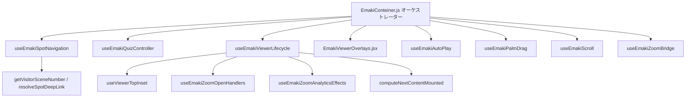

# EmakiConteiner レイアウトモジュール構成（Step 2）

## モジュール構成図

## 責務一覧

| モジュール | 責務 |
|-----------|------|
| `EmakiConteiner.js` | Props 受け取り、フック呼び出し順序、`.entry-container` / `<article>` DOM、子コンポーネント配線 |
| `useEmakiSpotNavigation` | スポット選択、`?spot` / `?scene` / ハッシュ深リンク、`history.replaceState`、ズーム連携 |
| `useEmakiQuizController` | クイズ遅延ロード、セッション永続化、`?quiz`、FAB、ジャンプ |
| `useEmakiViewerLifecycle` | 絵巻切替時 store リセット、ホイールスクロール、`wheel_toast_shown` |
| `useViewerTopInset` | フローティング解説用 `--emaki-top-inset` 測定 |
| `useEmakiZoomOpenHandlers` / `useEmakiZoomAnalyticsEffects` | `trackZoomOpen` / `trackZoomClose` |
| `computeNextContentMounted` | スライス仮想化（描画窓） |
| `EmakiViewerOverlays.jsx` | Help / Quiz / Polaroid / フィードバック / プロンプト系オーバーレイ |

## フック呼び出し順序（不変条件）

1. `useEmakiAutoPlay`
2. `useEmakiQuizController`
3. **`useEmakiPalmDrag`** → `palmActiveRef`
4. **`useEmakiScroll`**（`palmActiveRef` を渡す）
5. `useEmakiSpotNavigation`
6. `useEmakiPrompts` / `useEmakiRailSync`
7. `useEmakiZoomOpenHandlers` → `useEmakiZoomPan` → `useEmakiZoomAnalyticsEffects`
8. `useScrollPositionRestore` → `useEmakiViewerLifecycle`
9. `useEmakiZoomBridge`

## `.entry-container` DOM 契約

| 属性 / クラス | 値 |
|--------------|-----|
| `className` | `js-scrollable entry-container` + optional `hasCommentaryBar` |
| `data-commentary-float` | フローティング解説時 `"true"` |
| `data-viewer-mode` | `resolveViewerLayoutMode().viewerMode` |
| `data-layout-placement` | `resolveViewerLayoutMode().layoutPlacement` |
| `ref` | `entryContainerRef` |
| CSS 変数（style） | `buildViewerThemeStyle(data)`、`--emaki-top-inset`（測定時） |
| `touchAction` | `pan-x pan-y` |

## 主要 Ref 配線

| Ref | 定義元 | 主な受け渡し先 |
|-----|--------|----------------|
| `articleRef` | EmakiConteiner | Scroll / AutoPlay / RailSync / Restore / Lifecycle |
| `entryContainerRef` | EmakiConteiner | ZoomPan / ZoomBridge / CommentaryBar / TopInset |
| `palmActiveRef` | useEmakiPalmDrag | useEmakiScroll |
| `zoomToSlicePercentRef` | EmakiConteiner | useEmakiZoomBridge / useEmakiSpotNavigation |
| `enterZoomRef` | EmakiConteiner | useEmakiZoomBridge |
| `contentWindowMountedRef` | EmakiConteiner | computeNextContentMounted |
| `detectCurrentSceneRef` | EmakiConteiner | Scroll / AutoPlay / Restore / Lifecycle |