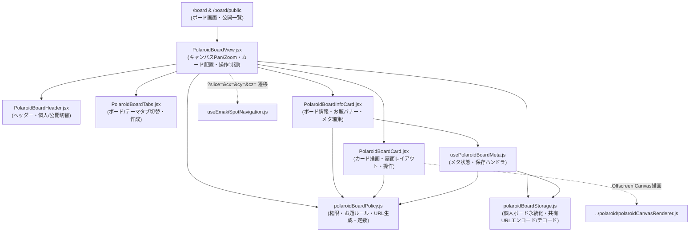
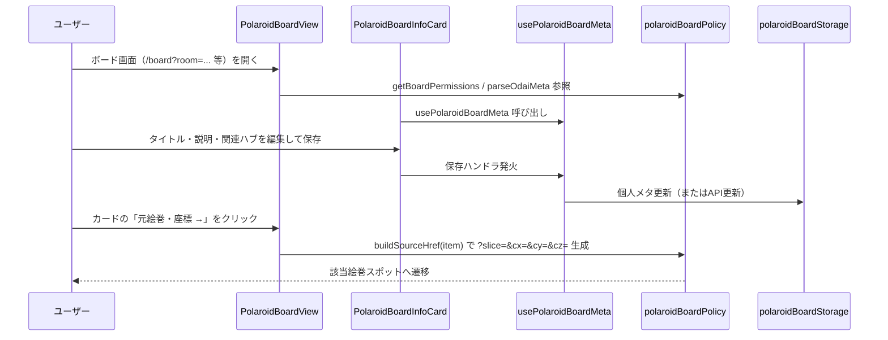

# ボード機能仕様書（`viewer/board`）

## 1. 全体アーキテクチャとファイル構成

`viewer/polaroid/` からボード関連モジュールを `viewer/board/` へ分離し、権限・お題ルール・URL生成・ハブ解決を `polaroidBoardPolicy.js` に集約しました。また、`PolaroidBoardInfoCard.jsx` 内で `usePolaroidBoardMeta` を直接利用することで、`PolaroidBoardView.jsx` からの過剰なメタ関連Propsバケツリレーを削減しています。

## 2. 主要ファイルと責務一覧

| ファイル | 種別 | 主な責務 |
|---------|------|----------|
| `PolaroidBoardView.jsx` | View / Orchestrator | ボード画面全体の統括、キャンバスPan/Zoom、カードドラッグ/選択、共有ボードの個人保存 |
| `PolaroidBoardHeader.jsx` | View | ボード上部ヘッダー、個人ボード／公開ボードモード切替 |
| `PolaroidBoardTabs.jsx` | View | タブ一覧表示、タブ選択、新規テーマ作成トリガー |
| `PolaroidBoardInfoCard.jsx` | View + State | ボードタイトル・説明・関連ハブ編集、お題バナー表示、`usePolaroidBoardMeta` 連携 |
| `PolaroidBoardCard.jsx` | View | 単体カード（ポラロイド／扇面 `layoutMode: "senmen"`）描画、いいね・共有・公開投稿・元絵巻リンク |
| `usePolaroidBoardMeta.js` | Hook / State | 個人・公開ボードのメタ情報状態管理、`<!--hubs:...-->` パース/シリアライズ、保存ハンドラ |
| `polaroidBoardPolicy.js` | Pure Logic | 権限判定（`getBoardPermissions` / `getBoardCardPermissions`）、お題ルール（`parseOdaiMeta` / `computeCardRuleBadges`）、`buildSourceHref`、`resolveRelatedThemeHub`、ストレージキー定数 |
| `polaroidBoardStorage.js` | Storage | localStorage への個人ボードCRUD、共有URL用Base64URLエンコード/デコード |
| `PolaroidBoardView.module.css` | Style | ボードレイアウト・キャンバス・カード関連スタイル |

## 3. 主要データフロー

## 4. 削除・統合済みレガシーファイル一覧

| 旧ファイル | 対応内容 | 統合先 / 備考 |
|-----------|----------|---------------|
| `polaroidBoardHelpers.js` | 削除（機能統合） | `polaroidBoardPolicy.js` に `ACTIVE_COLLAB_ROOM_KEY`・`AUTHOR_NAME_KEY`・`resolveRelatedThemeHub`・`buildSourceHref` を統合 |