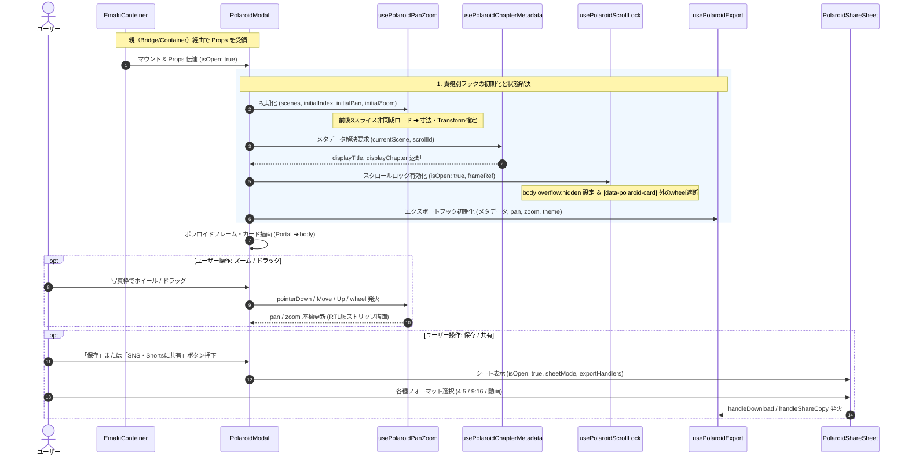

### 1. 全体アーキテクチャと親子階層マップ（追記・更新版）

`ChildScope` 内に、新設された2つのカスタムフックと1つのサブコンポーネントを追加し、各モジュール間の参照関係を明確化しました。

```mermaid
graph TD
    subgraph ParentScope["【親・外部の世界】絵巻ビューア本体"]
        Container["EmakiConteiner.js<br/>(モーダル開閉ステート・Propsリレー)"]
        Bridge["useEmakiZoomBridge.js<br/>(スライス決定・初期Pan/Zoom計算)"]
        SceneDom["emakiSceneDom.js<br/>(通常時: viewport中央のDOM判定)"]
        ZoomUI["ZoomLayer.jsx<br/>(ズーム時: data-zoom-strip 拡大オーバーレイ)"]

        Container -->|通常カメラ押下| Bridge
        Bridge -->|findSceneIndexAtViewportCenter| SceneDom
        SceneDom -->|probedCenterIndex| Bridge

        Container -->|ズーム突入・表示| ZoomUI
        ZoomUI -->|onCapture (ズーム撮影)| Bridge
        Bridge -.->|物理DOMサンプリング (cx, cy)| ZoomUI

        Bridge -->|polaroidSceneIndex / initialPan / initialZoom| Container
    end

    Container -->|Props (境界線)| Modal

    subgraph ChildScope["【子・内部の世界】polaroid/ ディレクトリ"]
        Modal["PolaroidModal.js<br/>(UIシェル・薄い親コンポーネント)"]
        Hook["usePolaroidPanZoom.js<br/>(wheel / drag / pinch / clamp)"]
        MetaHook["usePolaroidChapterMetadata.js<br/>(詞書・章タイトル・作品名解決)"]
        ScrollHook["usePolaroidScrollLock.js<br/>(bodyスクロール固定・wheel漏洩遮断)"]
        Export["usePolaroidExport.js<br/>(Canvas合成・エクスポート制御)"]
        Renderer["polaroidCanvasRenderer.js<br/>(Offscreen Canvas ピクセル描画)"]
        ShareUI["PolaroidShareSheet.jsx<br/>(共有・保存フォーマット選択UI)"]

        Modal <-->|Refs, Events, States| Hook
        Modal -->|scenes, currentScene| MetaHook
        Modal -->|isOpen, frameRef| ScrollHook
        Modal -->|Meta, States, Handlers| Export
        Modal -->|SheetProps, Handlers| ShareUI

        Export -->|Draw Context| Renderer
    end

    %% バグの発生境界線
    classDef bugZone fill:#fee2e2,stroke:#ef4444,stroke-width:2px;
    class Bridge,Modal,SceneDom,ZoomUI bugZone;

```

---

### 2. 外部・内部モジュールの責務一覧（追加分）

`SPEC.md` の第2章「モジュール詳細責務一覧」に追加する行です。

| レイヤー | モジュール名 | 主要責務 | 入力（Data In） | 出力・作用（Data Out / Side Effect） |
| --- | --- | --- | --- | --- |
| 子 (メタデータ) | `usePolaroidChapterMetadata.js` | ・過去の直近「詞書（ekotoba）」からの章名逆引き<br>

<br>・源氏物語の帖番号解決および多言語（日/英）切り替え | `scenes`, `currentScene`, `scrollId`, `isEn` 等 | `displayTitle`, `displayChapter` |
| 子 (スクロール制御) | `usePolaroidScrollLock.js` | ・モーダル表示中の `document.body` スクロール物理遮断<br>

<br>・`data-polaroid-card` 外での wheel イベント `preventDefault` | `isOpen`, `frameRef` | DOM 副作用（`body.style.overflow`, wheel リスナー） |
| 子 (共有ダイアログ) | `PolaroidShareSheet.jsx` | ・4:5 ポラロイド静止画 / 9:16 リール / ループ動画の選択肢提示<br>

<br>・クリップボード貼付案内ステップ表示 | `sheetMode`, `shareStep`, エクスポート用ハンドラ群 | 共有・保存の各アクション発火、UI レンダー |

---

### 3. 動的データフロー（シーケンス図・更新版）

マウント後の初期化および各フックの呼び出し順序・データ受け渡しを反映したシーケンス図です。

