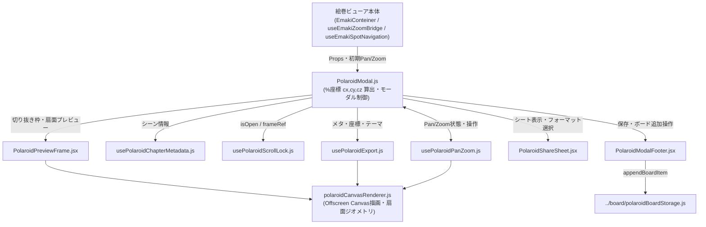
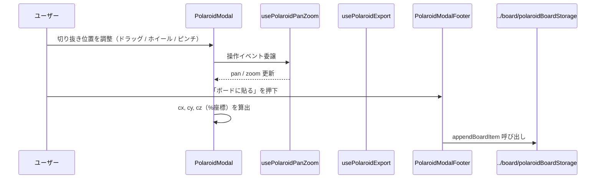

# ポラロイド・扇面作成モーダル仕様書（`viewer/polaroid`）

## 1. 全体アーキテクチャとファイル構成

`viewer/polaroid/` はポラロイドおよび扇面（`layoutMode: "senmen"`）の切り抜き・Pan/Zoom・Canvas描画・共有/保存モーダルに特化した構成とし、ボード画面・ポリシー・永続化モジュールは `viewer/board/` へ分離しています。

## 2. 主要ファイルと責務一覧

| ファイル | 種別 | 主な責務 |
| --- | --- | --- |
| PolaroidModal.js | View / Orchestrator | モーダル描画、実描画領域からの % 座標（cx, cy, cz）算出、各フック・サブUIの統合 |
| PolaroidPreviewFrame.jsx | View | ポラロイド／扇面（senmen）レイアウトの写真表示フレーム、扇面SVG逆抜きマスク、3スライスパノラマストリップ描画 |
| usePolaroidPanZoom.js | Hook | ホイール／ドラッグ／ピンチ操作による Pan・Zoom 更新とクランプ |
| usePolaroidChapterMetadata.js | Hook | 詞書・章タイトル・作品名メタデータの解決 |
| usePolaroidScrollLock.js | Hook | モーダル表示中の body スクロール固定とカード外 wheel イベント遮断 |
| usePolaroidExport.js | Hook | 4:5 / 9:16 / 動画などの Canvas 合成・ダウンロード・共有制御 |
| polaroidCanvasRenderer.js | Pure Logic / Canvas | テーマテクスチャ・扇面ジオメトリ（getSenmenFanGeometry）・Canvasピクセル描画 |
| PolaroidShareSheet.jsx | View | 保存・SNS/Shorts 共有フォーマット選択 UI |
| PolaroidModalFooter.jsx | View | フッターアクション（ボードへ追加・保存・共有トリガー） |
| PolaroidModal.anim.module.css | Style | ポラロイドモーダルのアニメーション・レイアウトスタイル |

## 3. 主要データフロー

## 4. viewer/board/ へ移管・統合済みファイル一覧

以下のファイルは `viewer/polaroid/` から `viewer/board/` へ移管、または `polaroidBoardPolicy.js` へ統合されました。

- `viewer/board/PolaroidBoardView.jsx`
- `viewer/board/PolaroidBoardHeader.jsx`
- `viewer/board/PolaroidBoardTabs.jsx`
- `viewer/board/PolaroidBoardInfoCard.jsx`
- `viewer/board/PolaroidBoardCard.jsx`
- `viewer/board/PolaroidBoardView.module.css`
- `viewer/board/usePolaroidBoardMeta.js`
- `viewer/board/polaroidBoardPolicy.js`（旧 `polaroidBoardHelpers.js` の定数・ヘルパーを統合）
- `viewer/board/polaroidBoardStorage.js`