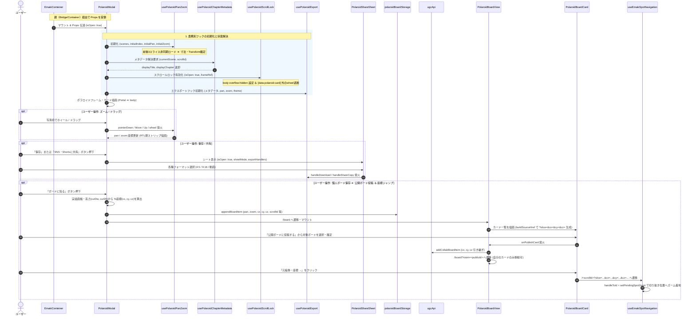

### 1. 全体アーキテクチャと親子階層マップ（リファクタリング・公開ボード対応版）

`ChildScope` に切り抜き座標の `%` 変換・保存処理を追加し、`BoardScope` については肥大化していた `PolaroidBoardView.jsx` を責務ごとに4つのモジュール（オーケストレータ・ヘッダー・単体カード・純粋ヘルパー）へ分割しました。また、公開ボード一覧ページ（`/board/public`）およびスポット座標ディープリンク復元（`useEmakiSpotNavigation.js`）との連携を反映しています。

```mermaid
graph TD
    subgraph ParentScope["【親・外部の世界】絵巻ビューア本体"]
        Container["EmakiConteiner.js<br/>(モーダル開閉ステート・Propsリレー)"]
        Bridge["useEmakiZoomBridge.js<br/>(スライス決定・初期Pan/Zoom計算)"]
        SceneDom["emakiSceneDom.js<br/>(通常時: viewport中央のDOM判定)"]
        ZoomUI["ZoomLayer.jsx<br/>(ズーム時: data-zoom-strip 拡大オーバーレイ)"]
        SpotNav["useEmakiSpotNavigation.js<br/>(?slice & ?cx,cy,cz 座標ジャンプ着地)"]

        Container -->|通常カメラ押下| Bridge
        Bridge -->|findSceneIndexAtViewportCenter| SceneDom
        SceneDom -->|probedCenterIndex| Bridge

        Container -->|ズーム突入・表示| ZoomUI
        ZoomUI -->|onCapture ズーム撮影| Bridge
        Bridge -.->|物理DOMサンプリング cx, cy| ZoomUI

        Bridge -->|polaroidSceneIndex / initialPan / initialZoom| Container
    end

    Container -->|Props 境界線| Modal

    subgraph ChildScope["【子・内部の世界】polaroid/ ディレクトリ"]
        Modal["PolaroidModal.js<br/>(UIシェル・%座標 cx,cy,cz 算出・保存)"]
        Hook["usePolaroidPanZoom.js<br/>(wheel / drag / pinch / clamp)"]
        MetaHook["usePolaroidChapterMetadata.js<br/>(詞書・章タイトル・作品名解決)"]
        ScrollHook["usePolaroidScrollLock.js<br/>(bodyスクロール固定・wheel漏洩遮断)"]
        Export["usePolaroidExport.js<br/>(Canvas合成・エクスポート制御)"]
        Renderer["polaroidCanvasRenderer.js<br/>(Offscreen Canvas ピクセル描画)"]
        ShareUI["PolaroidShareSheet.jsx<br/>(共有・保存フォーマット選択UI)"]

        Modal <-->|Refs, Events, States| Hook
        Modal -->|scenes, currentScene| MetaHook
        Modal -->|isOpen, frameRef| ScrollHook
        Modal -->|Meta, States, Handlers| Export
        Modal -->|SheetProps, Handlers| ShareUI

        Export -->|Draw Context| Renderer
        Modal -->|appendBoardItem cx,cy,cz付| BoardStore["polaroidBoardStorage.js<br/>(localStorage永続化 / Base64URL圧縮)"]
        Modal -->|addCollabBoardItem| UgcApi["ugcApi.js<br/>(公開/限定共有ボードAPI)"]
    end

    Modal -->|router.push '/board'| BoardPage

    subgraph BoardScope["【独立ページ領域】ポラロイド・ホワイトボード (/board & /board/public)"]
        BoardPage["src/pages/board.js<br/>(個人・限定共有・公開ボード統合エントリ)"]
        PublicPage["src/pages/board/public.js<br/>(公開ボード一覧・新規テーマ作成)"]
        BoardView["PolaroidBoardView.jsx<br/>(無限キャンバスPan/Zoom・権限別ドラッグ制御)"]
        BoardHeader["PolaroidBoardHeader.jsx<br/>(1行統一ヘッダー・テーマ説明編集・関連作品導線)"]
        BoardCard["PolaroidBoardCard.jsx<br/>(単体カード・プレビュー・いいね/共有・公開投稿)"]
        BoardHelpers["polaroidBoardHelpers.js<br/>(buildSourceHref / resolveRelatedThemeHub / 定数)"]
        BoardCSS["PolaroidBoardView.module.css<br/>(CSS Module スタイリング)"]

        BoardPage --> BoardView
        PublicPage -->|fetchPublicBoards / createCollabBoard| UgcApi
        PublicPage -->|router.push '/board?room=...'| BoardPage

        BoardView --> BoardHeader
        BoardView --> BoardCard
        BoardView --> BoardHelpers
        BoardHeader --> BoardHelpers
        BoardView <-->|load / save / encode / decode| BoardStore
        BoardView <-->|CRUD / Meta更新| UgcApi
        BoardCard -->|THEMES / PHOTO_DW,DH / Texture| Renderer
        BoardCard -->|/?slice=...&cx=...&cy=...&cz=...| SpotNav
        BoardView -.-> BoardCSS
    end

    %% バグの発生境界線
    classDef bugZone fill:#fee2e2,stroke:#ef4444,stroke-width:2px;
    class Bridge,Modal,SceneDom,ZoomUI bugZone;
```

---

### 2. 外部・内部モジュールの責務一覧（更新版）

`SPEC.md` の第2章「モジュール詳細責務一覧」の更新内容です。

| レイヤー | モジュール名 | 主要責務 | 入力（Data In） | 出力・作用（Data Out / Side Effect） |
| :--- | :--- | :--- | :--- | :--- |
| **親 (ナビゲーション)** | `useEmakiSpotNavigation.js` | ・`?spot=` ディープリンクおよびポラロイド由来の `?slice=&cx=&cy=&cz=` 座標着地・ズーム復元 | `query.spot`, `query.slice`, `query.cx/cy/cz`, `data.emakis` | `handleToId` による横スクロール位置合わせ、`setPendingSpotZoom` によるズーム復元 |
| **子 (モーダル親)** | `PolaroidModal.js` | ・切り抜き枠の UI シェルおよび前後3スライス描画 ・保存時に実描画寸法（`curDw`, `curDh`）からスライス内 `%` 座標（`cx`, `cy`, `cz`）を算出して付与 | `scenes`, `selectedIndex`, `pan`, `zoom`, `coverScale` | `appendBoardItem` / `addCollabBoardItem` への座標付きペイロード送信 |
| **子 (メタデータ)** | `usePolaroidChapterMetadata.js` | ・過去の直近「詞書（ekotoba）」からの章名逆引き ・源氏物語の帖番号解決および多言語（日/英）切り替え | `scenes`, `currentScene`, `scrollId`, `isEn` 等 | `displayTitle`, `displayChapter` |
| **子 (スクロール制御)** | `usePolaroidScrollLock.js` | ・モーダル表示中の `document.body` スクロール物理遮断 ・`data-polaroid-card` 外での `wheel` イベント `preventDefault` | `isOpen`, `frameRef` | DOM 副作用（`body.style.overflow`, `wheel` リスナー） |
| **子 (共有ダイアログ)** | `PolaroidShareSheet.jsx` | ・4:5 ポラロイド静止画 / 9:16 リール / ループ動画の選択肢提示 ・クリップボード貼付案内ステップ表示 | `sheetMode`, `shareStep`, エクスポート用ハンドラ群 | 共有・保存の各アクション発火、UI レンダー |
| **子 (ボード永続化)** | `polaroidBoardStorage.js` | ・`localStorage`（最大30件）への個人ボードアイテムCRUD ・UTF-8 Base64URL による圧縮共有URLのエンコード／デコード | `payload`, `items`, `locale`, クエリ `d` | `localStorage` 書込、`/ja/board?d=...` 生成、アイテム配列復元 |
| **子 (ボード本体)** | `PolaroidBoardView.jsx` | ・無限キャンバスのパン＆ズームおよびカード配置管理 ・公開/限定共有ボードにおける「自分のカードだけ移動可（`canEdit !== false`）」の権限制御 ・個人ボードから公開ボードへの投稿オーケストレーション | `router.query.d`, `router.query.room`, `localStorage`, `ugcApi` | カード座標・メモ永続化、API同期、子コンポーネントへの状態供給 |
| **子 (ボードヘッダー)** | `PolaroidBoardHeader.jsx` | ・個人／限定共有／公開の3状態に応じた1行統一ツールバー描画 ・公開ボードのタイトル・テーマ説明（`description`）のインライン編集・保存 ・テーマ名／説明に応じた関連作品ハブ導線の表示 | `isCollabMode`, `isSharedMode`, `collabBoard`, 各ハンドラ | ボードメタ更新発火、公開一覧・個人ボード・関連作品ハブへの遷移 |
| **子 (ボードカード)** | `PolaroidBoardCard.jsx` | ・単体ポラロイドカードの描画・プレビュー（`PolaroidCardPreview`） ・カード単位の「いいね」「共有URLコピー」「元絵巻・座標リンク」表示 ・個人ボード上の「公開ボードに投稿する」ピッカーUI | `item`, `isSelected`, `sourceHref`, `publicBoards`, 各種操作コールバック | ドラッグ開始イベント、メモ変更、いいね／共有／公開投稿アクション発火 |
| **子 (ボードヘルパー)** | `polaroidBoardHelpers.js` | ・`buildSourceHref`（`?slice=&cx=&cy=&cz=` クエリ生成、旧データのフォールバック変換） ・`resolveRelatedThemeHub`（テーマキーワードから絵巻ハブパス解決） ・ストレージキー定数定義 | `item`, テーマ文字列 | 遷移先URL文字列、ハブ情報オブジェクト、定数 |
| **ページ (ボード)** | `src/pages/board.js` `src/pages/board/public.js` | ・`/board`（個人・限定共有・公開ボード）および `/board/public`（公開ボード一覧・新規作成）のルーティングエントリ ・`serverSideTranslations` による日英ロケール供給 | `locale`, `query` | `<Head>` メタ出力、`PolaroidBoardView` / 公開一覧UIマウント |

---

### 3. 動的データフロー（シーケンス図・更新版）

ポラロイド保存時の `%` 座標算出、個人ボードから公開ボードへの投稿、およびカードからの座標ジャンプ復元を含めたシーケンス図です。

## 2. ボード権限・ルールポリシー（polaroidBoardPolicy.js）と拡張ガイド

個人ボード・共有URL・公開コラボボード（および将来のユーザー作成公開ボード）の権限とルール判定は、すべて `polaroidBoardPolicy.js` を単一信頼源（Single Source of Truth）として参照します。

### ボード種別ごとの権限マトリクス（getBoardPermissions / getBoardCardPermissions）

| ボード種別 (BOARD_MODES) | カード投稿 (canPostItem) | カード移動・メモ編集 (canDrag / canEditMemo) | カード削除 (canDelete) | ボードタイトル・説明編集 (canEditBoardMeta) | 新規テーマ作成 (canCreateTheme) | 永続化先 |
|---|---|---|---|---|---|---|
| 個人ボード (personal) | ○ | ○ | ○ | ○ | ○ | localStorage |
| 共有URL (shared) | × | ×（閲覧専用） | × | × | × | URLパラメータ |
| 公開コラボ (collab) | ○（お題上限内） | 投稿者本人 or 管理者 | 投稿者本人 or 管理者 | 作成者 (isOwner) or 管理者 | 作成者 (isOwner) or 管理者 | DB API (`/api/board/[id]`) |

### 今後の安全なルール・ボード拡張手順

**新しいお題ルール**（例：特定作品限定・時代限定など）を追加する場合:

- `polaroidBoardPolicy.js` の `ODAI_RULE_MODES` と `parseOdaiMeta(description)` にデフォルトプロパティを追加し、`computeCardRuleBadges(items, odaiMeta, isEn)` にバッジ判定ロジックを1ケース追加するだけで、ボード全体のカードUIへ自動反映されます。

**一般ユーザーによる公開ボード作成機能**を追加する場合:

- API レスポンスの `board.isOwner` を `getBoardPermissions({ isCollabMode, isSharedMode, isBoardAdmin, isBoardOwner })` に渡す設計がすでに組み込まれているため、作成者本人にのみボード設定・テーマ作成権限が自動で付与されます。

### 扇面レイアウト（layoutMode: `"senmen"`）の連携仕様

- 形状（`layoutMode: "polaroid" | "senmen"`）とカラーテーマ（`currentTheme: white | washi | sumi | miyabi`）は完全に独立しています。
- ボード保存時は API スキーマ変更を避けるため `theme` 文字列に `:senmen` サフィックス（例: `white:senmen`）を付与して永続化し、`PolaroidBoardCard.jsx` の `parseCardThemeAndMode` で復元して横長扇面フレーム（264×144）を描画します。