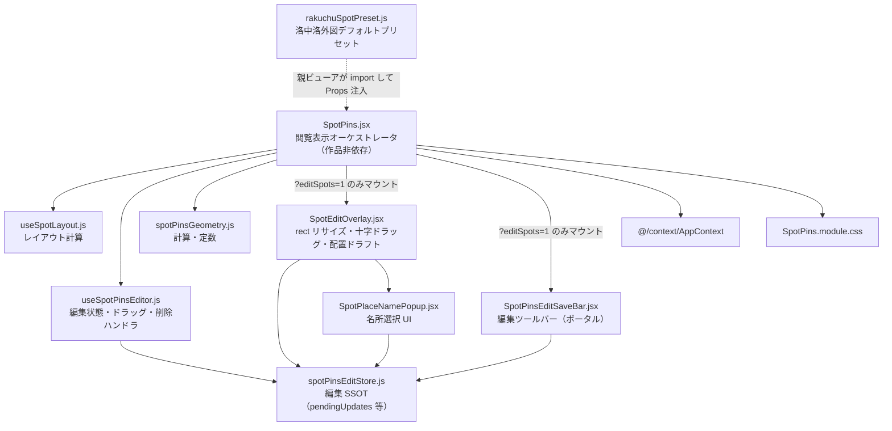
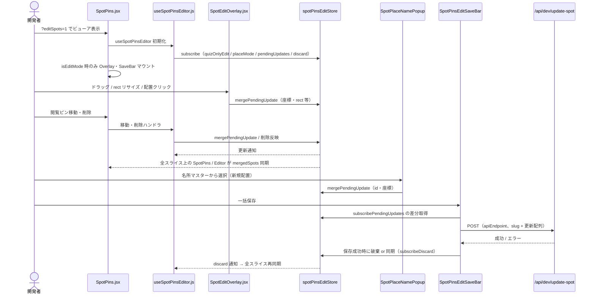

# SpotPins モジュール仕様

絵巻ビューア上の名所スポットピン（アノテーション）オーバーレイ。親 `section`（`position: relative`）内に x/y%（スライス左上原点）でタグを重ねる。

**公開コンポーネント:** `SpotPins.jsx` の `export default SpotPins`

---

## 1. ファイル構成



---

## 2. 責務一覧

| 層 | ファイル | 責務 | 主要な公開 API |
|----|----------|------|----------------|
| **閲覧・合成（オーケストレータ）** | `../SpotPins.jsx` | 通常閲覧のピン描画・選択・いいね操作。`useSpotLayout` / `useSpotPinsEditor` の配線。編集モード時のみ `SpotPinsEditSaveBar` と `SpotEditOverlay` を合成マウント。作品固有定数は持たない | **Props:** `spots`, `linkId`, `zoomScale`, `sliceIndex`, `masterSpots`, `getSpotKindClass`, `slugOverride`, `apiEndpoint`（default: `"/api/dev/update-spot"`）<br/>**Export:** `export default SpotPins` |
| **編集ロジック（フック）** | `useSpotPinsEditor.js` | `isEditMode` 判定（`?editSpots=1` + development）。ストア購読（`quizOnlyEdit`, `placeMode`, `pendingUpdates`, `discard`）、`mergedSpots` 合成、ピン移動・削除ハンドラを `SpotPins` へ返す | `useSpotPinsEditor`（`mergedSpots`, 編集ハンドラ群, `isEditMode` 等） |
| **レイアウト** | `useSpotLayout.js` | スライス要素とオーバーレイの座標同期、リサイズ・`zoomScale` に追従するレイアウト実測 | `useSpotLayout`（section 参照・ピン座標用メトリクス等） |
| **状態（SSOT）** | `spotPinsEditStore.js` | スポット編集の未保存差分（`pendingUpdates`）、配置モード（`placeMode`）、`quizOnlyEdit` を slug 単位で保持・通知 | `getPlaceModeEnabled`, `setPlaceModeEnabled`, `subscribePlaceMode`, `registerNewSpot`, `mergePendingUpdate`, `getAddedSpotsForSlug`, `getPlacedSpotIdsForSlug`, `registerSliceSpotIds`, `subscribePendingUpdates`, `subscribeDiscard` |
| **計算・定数** | `spotPinsGeometry.js` | バッジ余白、エッジマージン、スライス画像名抽出、フォールバックオフセット、slug 解決、transform-origin | `BADGE_GAP`, `EDGE_MARGIN`, `extractSliceImageName`, `fallbackOffset`, `getSlugFromPath`, `transformOriginFor` |
| **プリセット（作品別・親注入）** | `rakuchuSpotPreset.js` | 洛中洛外屏風向けの名所マスター既定値・種別スタイル等。`SpotPins` 本体には埋め込まない | `RAKUCHU_SPOT_MASTERS`, `getRakuchuSpotKindClass` 等（ビューア親から Props として渡す） |
| **UI 表示（編集オーバーレイ）** | `SpotEditOverlay.jsx` | `rect` リサイズハンドル、中心十字ドラッグ、新規スポット配置ドラフト。名所ポップアップのトリガ | **Props:** `SpotPins` が `isEditMode` 時に委譲 |
| **UI 表示** | `SpotPlaceNamePopup.jsx` | 編集時の名所マスターからの選択ポップアップ | **Props:** 親から `masterSpots` 等を受け取り store と連携 |
| **UI 表示（編集ツールバー）** | `SpotPinsEditSaveBar.jsx` | ポータル描画の編集ツールバー。クイズ枠のみ表示切替・JSON 一括保存・破棄 | **Props:** `slugOverride`, `apiEndpoint` 等（`SpotPins` が `isEditMode` 時に直結） |

---

## 3. データフロー（開発編集 `?editSpots=1`）

前提: `NODE_ENV === "development"` かつ URL クエリ `editSpots=1`。slug は `slugOverride` または `getSlugFromPath(router.asPath)`。



---

## 4. 汎用利用ガイド（他絵巻・他コンテンツ）

Phase-2 以降、`SpotPins.jsx` は作品非依存の純粋汎用コンポーネント。洛中洛外向けの既定マスター・種別スタイルは `rakuchuSpotPreset.js` に分離し、**ビューア親（例: 洛中洛外用スイッチャー）が import して Props として注入**する。

### 基本配置

親スライス `section` 内で、同期済み `spots` 配列を渡す（屏風では `scenes[].spots` を扇 index へ振り分けた結果）。

```jsx
import SpotPins from "@/components/emaki/viewer/SpotPins";
import { RAKUCHU_SPOT_MASTERS, getRakuchuSpotKindClass } from "@/components/emaki/viewer/spotPins/rakuchuSpotPreset";

<SpotPins
  spots={spotsForThisSlice}
  linkId={scrollLinkId}
  sliceIndex={sliceIndex}
  zoomScale={zoomScale}
  masterSpots={RAKUCHU_SPOT_MASTERS}
  getSpotKindClass={getRakuchuSpotKindClass}
/>
```

他絵巻は `rakuchuSpotPreset.js` を使わず、自前の `masterSpots` / `getSpotKindClass`（または `null`）だけを渡せばよい。

### 汎用 Props

| Prop | 型 | デフォルト | 用途 |
|------|-----|----------|------|
| `masterSpots` | 配列 | なし（親が渡す） | 編集モードで選択する名所マスター。洛中洛外は `rakuchuSpotPreset.js` から注入。 |
| `getSpotKindClass` | `function \| null` | 未定義 | `(spot, styles) => string`。種別ごとの CSS Module クラス。`null` でバッジ種別スタイルを無効化。 |
| `slugOverride` | `string` | 未定義 | メタ JSON / API の scroll slug を URL から取れない場合に明示指定。SaveBar・store のキーにも使用。 |
| `apiEndpoint` | `string` | `"/api/dev/update-spot"` | 開発用一括保存先。別プロジェクト用エンドポイントに差し替え可能。 |

### 種別スタイル（`getSpotKindClass`）

- **未指定:** 種別用 CSS Module クラスを付けない（汎用最小表示）。
- **関数:** 返したクラス名をピン `button` に付与。洛中洛外は `getRakuchuSpotKindClass` を渡す。
- **`null`:** 種別クラスを付けない（最小表示）。

### 後方互換

- Props 名は上記のとおり。**export 名は `SpotPins`（default）のみ。**
- 洛中洛外の従来デフォルトは `SpotPins` 内ではなく `rakuchuSpotPreset.js` に移動。既存洛中洛外ビューアは親側でプリセットを import して渡すことで同等動作となる。`apiEndpoint` の default（`"/api/dev/update-spot"`）と path からの `slug` 解決は `SpotPins` 側のまま。
- 本番ビルドでは `editSpots` クエリがあっても `isEditMode` は development 限定のため、編集 UI は本番に出ない。

### 他コンテンツチェックリスト

1. スポット JSON 形式を既存 `spots` エントリ（`id`, `name`, `x`, `y`, …）に合わせる。
2. `masterSpots` に編集用候補一覧を渡す（開発時のみ参照）。
3. 保存 API が `slug` + 更新配列を受け取れることを確認し、必要なら `apiEndpoint` を変更。
4. URL が `[slug]` パターンでない場合は `slugOverride` を必須化。