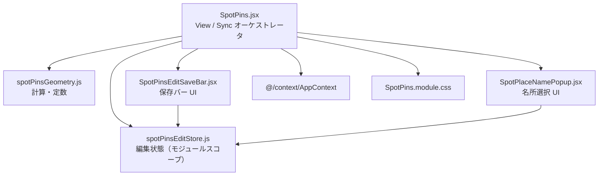
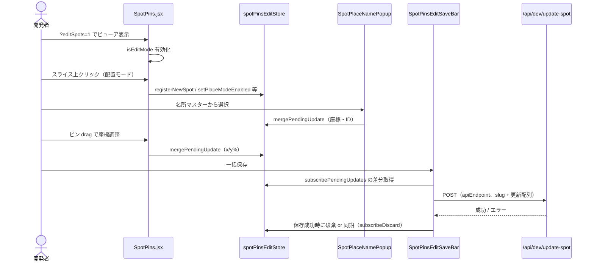

# SpotPins モジュール仕様

絵巻ビューア上の名所スポットピン（アノテーション）オーバーレイ。親 `section`（`position: relative`）内に x/y%（スライス左上原点）でタグを重ねる。

**公開コンポーネント:** `SpotPins.jsx` の `export default SpotPins`

---

## 1. ファイル構成



---

## 2. 4層責務一覧

| 層 | ファイル | 責務 | 主要な公開 API |
|----|----------|------|----------------|
| **同期・表示（オーケストレータ）** | `../SpotPins.jsx` | スポット描画、クリック→段スクロール、編集モード配線、`spots` と DOM の同期 | **Props:** `spots`, `linkId`, `zoomScale`, `sliceIndex`, `masterSpots`, `getSpotKindClass`, `slugOverride`, `apiEndpoint`（default: `"/api/dev/update-spot"`）<br/>**Export:** `export default SpotPins` |
| **状態** | `spotPinsEditStore.js` | 開発編集用の配置モード、未保存差分、スライスごとの追加 ID（slug 単位） | `getPlaceModeEnabled`, `setPlaceModeEnabled`, `subscribePlaceMode`, `registerNewSpot`, `mergePendingUpdate`, `getAddedSpotsForSlug`, `getPlacedSpotIdsForSlug`, `registerSliceSpotIds`, `subscribePendingUpdates`, `subscribeDiscard` |
| **計算・定数** | `spotPinsGeometry.js` | バッジ余白、エッジマージン、スライス画像名抽出、フォールバックオフセット、slug 解決、transform-origin | `BADGE_GAP`, `EDGE_MARGIN`, `extractSliceImageName`, `fallbackOffset`, `getSlugFromPath`, `transformOriginFor` |
| **UI 表示** | `SpotPlaceNamePopup.jsx` | 編集時の名所マスターからの選択ポップアップ | **Props:** 親から `masterSpots` 等を受け取り store と連携 |
| **UI 表示** | `SpotPinsEditSaveBar.jsx` | 未保存件数表示・一括保存・破棄 | **Props:** `slugOverride`, `apiEndpoint` 等（親 `SpotPins` から委譲） |

---

## 3. データフロー（開発編集 `?editSpots=1`）

前提: `NODE_ENV === "development"` かつ URL クエリ `editSpots=1`。slug は `slugOverride` または `getSlugFromPath(router.asPath)`。



---

## 4. 汎用利用ガイド（他絵巻・他コンテンツ）

### 基本配置

親スライス `section` 内で、同期済み `spots` 配列を渡す（屏風では `scenes[].spots` を扇 index へ振り分けた結果）。

```jsx
import SpotPins from "@/components/emaki/viewer/SpotPins";

<SpotPins
  spots={spotsForThisSlice}
  linkId={scrollLinkId}
  sliceIndex={sliceIndex}
  zoomScale={zoomScale}
/>
```

### 汎用 Props

| Prop | 型 | デフォルト | 用途 |
|------|-----|----------|------|
| `masterSpots` | 配列 | `RAKUCHU_SPOT_MASTERS` | 編集モードで選択する名所マスター。他絵巻は自前マスターを渡す。 |
| `getSpotKindClass` | `function \| null` | 未定義 | `(spot, styles) => string`。種別ごとの CSS Module クラス。`null` でバッジ種別スタイルを無効化。 |
| `slugOverride` | `string` | 未定義 | メタ JSON / API の scroll slug を URL から取れない場合に明示指定。SaveBar・store のキーにも使用。 |
| `apiEndpoint` | `string` | `"/api/dev/update-spot"` | 開発用一括保存先。別プロジェクト用エンドポイントに差し替え可能。 |

### 種別スタイル（`getSpotKindClass`）

- **未指定:** 内部で `getSpotVisualKind`（楽遂マスター連携）等の既定ロジックを使用。
- **関数:** 返したクラス名をピン `button` に付与。
- **`null`:** 種別クラスを付けない（最小表示）。

### 後方互換

- Props 名は上記のとおり。**export 名は `SpotPins`（default）のみ。**
- `masterSpots` / `getSpotKindClass` / `slugOverride` / `apiEndpoint` を省略した場合、洛中洛外屏風向けデフォルト（`RAKUCHU_SPOT_MASTERS`、`/api/dev/update-spot`、path からの slug）で従来どおり動作。
- 本番ビルドでは `editSpots` クエリがあっても `isEditMode` は development 限定のため、編集 UI は本番に出ない。

### 他コンテンツチェックリスト

1. スポット JSON 形式を既存 `spots` エントリ（`id`, `name`, `x`, `y`, …）に合わせる。
2. `masterSpots` に編集用候補一覧を渡す（開発時のみ参照）。
3. 保存 API が `slug` + 更新配列を受け取れることを確認し、必要なら `apiEndpoint` を変更。
4. URL が `[slug]` パターンでない場合は `slugOverride` を必須化。