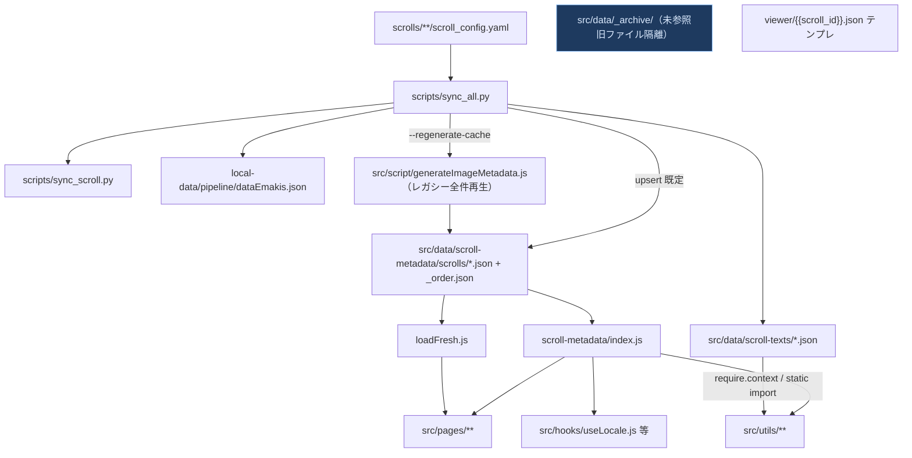
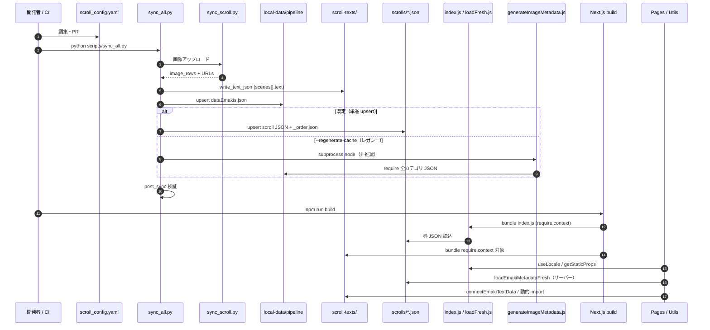

# src/data 境界仕様書（Phase 1 → Step 4 → Step B 命名統一）

**Step B（2026-11）:** 役割ベースのディレクトリ名 — `scroll-metadata/`, `scroll-texts/`, `hub/`, `persons/`, `master/`, `features/`。サーバー再読込は `scroll-metadata/loadFresh.js`（export 名 `loadEmakiMetadataFresh` は互換維持）。源氏・九相マスターは `genji-chapters.json` / `kusouzu-chapters.json`。

本書は `emakimono-next` における `src/data` 配下のデータ責務・生成経路・フロント読込境界を固定する。YAML 自動アップロード（`scroll-upload` / `scripts/sync_all.py`）と Next.js ビルドの import 互換を壊さないことが最優先契約である。

**Step 4（2026-11）:** 単一 `scroll-metadata.json` を廃止。絵巻メタ正本は `scroll-metadata/scrolls/{titleen}.json` と `scrolls/_order.json` のみ。フロントは `index.js`（`require.context`）と `loadFresh.js`（サーバー側 `fs` 再読込）で結合読込。実行コード未参照の旧ファイルは `src/data/_archive/` に隔離。`getLiveSlugs.js` の `DEBUG_DATA_CACHE` は `false`。

---

## 1. 全体アーキテクチャと親子階層マップ

**親子関係の要約**

| 層 | 正本 | 生成元 |
|---|---|---|
| パイプライン中間 | `local-data/pipeline/dataEmakis.json` | `sync_all.py`（git 管理外） |
| フロント絵巻メタ | `scroll-metadata/scrolls/{titleen}.json` + `_order.json` | `upsert_cache_entry`（sync）／分割正本 |
| フロント読込 | `index.js`, `loadFresh.js` | `require.context(scroll)`／`fs` 再読込（`[slug].js` 等） |
| 章テキスト | `scroll-texts/{titleen}.json` | `sync_all.py` `write_text_json` |
| 公開除外 | `libs/constants/withdrawnTitleen.json` | 手動（`src/data/withdrawn/` はアーカイブ参照用） |

---

## 2. 外部・内部モジュールの責務一覧

### 2.1 レイヤー責務表

| レイヤー | モジュール/ファイル名 | 主要責務 | 入力（Data In） | 出力・作用（Data Out / Side Effect） |
|---|---|---|---|---|
| YAML / ローカル | `scrolls/**/scroll_config.yaml` | 絵巻定義・scene・画像計画 | 画像ファイル・作者メタ | CI / 手動 sync の入力 |
| スクリプト | `scripts/sync_all.py` | 統合同期オーケストレーション | YAML, アップロード結果 | `dataEmakis.json`, `scrolls/*.json`, `scroll-texts` |
| スクリプト | `scripts/sync_scroll.py` | 画像アップロード（R2/Cloudinary） | YAML, 画像 | `image_rows`, URL/public_id |
| スクリプト | `src/script/generateImageMetadata.js` | レガシー：pipeline から全件再構築（分割正本移行後は非推奨） | `local-data/pipeline/*.json` | 旧 monolith 向け（廃止済み） |
| スクリプト | `scripts/scroll_checks/post_sync.py` | 同期後 JSON 検証 | CACHE, text-data | 検証レポート / exit code |
| データ正本 | `scroll-metadata/scrolls/` | 巻単位 JSON + `_order.json` | sync upsert | `index.js` 経由で Webpack バンドル・SSG |
| データ | `scroll-metadata/index.js` | クライアント／静的 import 入口 | `require.context("./scrolls")` | 絵巻配列エクスポート |
| データ | `loadFresh.js` | サーバー実行時の fs 再読込 | `scrolls/` ディレクトリ | `[slug].js` getStaticProps 等 |
| データ | `scroll-texts/` | 詞書・章テキスト | YAML `scenes[].text` | ビューア・ハブ・require.context |
| 境界 Utils | `src/utils/getLiveSlugs.js` | 公開 titleen 集合 | cache JSON | 年表・時代ページの live 判定 |
| 境界 Utils | `src/utils/emakiChapterText.js` | 章テキスト解決 | scroll-texts マップ | ビューア表示文字列 |
| Pages | `src/pages/[slug].js` | 絵巻ビューア | cache + runtime再読込 | SSG paths / 404 |
| Hooks | `src/hooks/useLocale.js` | ロケール付き絵巻配列 | cache JSON | 一覧・ランキング |

**YAML → cache 書き込みの実装箇所**

| ファイル | 関数 | 動作 |
|---|---|---|
| `scripts/sync_all.py` | `data_entry_to_cache_entry` | pipeline エントリをキャッシュ形式へ正規化 |
| `scripts/sync_all.py` | `upsert_cache_entry` | `titleen` 単位で `scrolls/{titleen}.json` 差し替え・`_order.json` 更新 |
| フロント | `scroll-metadata/index.js` | `require.context` で scrolls 結合・`_order` 順序適用 |
| フロント | `loadFresh.js` | 開発／ビルド後のメタ再読込（monolith 非依存） |

### 2.2 src/data 棚卸し（分類）

凡例: **①自動生成・正本** / **②静的参照中** / **③動的参照中** / **④未使用候補**

| ファイル | 行数 | サイズ | 分類 | 参照概要 |
|---|---:|---:|---|---|
| `scroll-metadata/scrolls/{titleen}.json` + `_order.json` | 巻ごと | 可変 | ①②③ | 正本；`index.js` / `loadFresh.js` |
| `scroll-metadata/index.js` | — | 2K | ③ | `@/data/scroll-metadata` デフォルト export |
| `scroll-metadata/loadFresh.js` | — | 1K | ③ | サーバー fs 読込 |
| `scroll-texts/{titleen}.json`（各巻） | 〜250 | 4–20K | ①③ | sync 生成 + `require.context` |
| `scroll-texts/genji-chapters.json` | 2449 | 220K | ② | 源氏マスター・静的 import |
| `scroll-texts/kusouzu-chapters.json` | 121 | 12K | ② | 九相図ハブ |
| `hub/hubData.js` | 403 | 16K | ② | emaki-hub / テーマカード |
| `hub/relatedMedia.js` | 61 | 4K | ② | emaki-hub メディア関連 |
| `features/mangaRoots.js` | 257 | 12K | ② | manga-roots ページ |
| `chronology/emakiTimeline.js` | 1385 | 36K | ② | timeline |
| `chronology/emakiTimelineSimple.js` | 467 | 20K | ② | 年表 UI |
| `folklore/folkloreItems.js` | 1167 | 56K | ② | 寓話インデックス |
| `folklore/folkloreIndex.js` | 39 | 4K | ② | ebiki / ビューア hook |
| `folklore/folkloreByTitleen.js` | 77 | 4K | ② | `useFolkloreForScroll` |
| `master/motifs.json` | 184 | 12K | ② | Commentary / motifNetwork |
| `master/generated-motif-index.json` | 0 | 4K | ①④ | `motifNetwork.js`（空ファイル・将来生成想定） |
| `master/references.json` | 184 | 8K | ② | `[slug].js` |
| `persons/profiles.json` | 230 | 12K | ② | personname / seoRedirects |
| `quiz/*.ts` + `quizStats.json` | 各〜260 | 4–16K | ② | クイズモーダル |
| `_archive/withdrawn/*.json` | — | — | ④ | **隔離済**（実制御は `withdrawnTitleen.json`） |
| `_archive/scroll-metadata/*` | — | — | ④ | **隔離済**（旧 monolith .bak、choju 断片、integration 等） |
| `_archive/scroll-texts/*_old.json`, `*.bak` | — | — | ④ | **隔離済** |
| `viewer/{{scroll_id}}.json` | 173 | 8K | ④ | スキーマテンプレ（実行時未 import） |

**プロジェクト内参照（dataEmakis / withdrawn / scroll-texts）**

| 参照対象 | 参照方式 | 主な参照元 |
|---|---|---|
| `dataEmakis.json` | `local-data/pipeline/`（gitignore） | `sync_all.py`, `generateImageMetadata.js` のみ。フロントは **直接 import しない** |
| `withdrawn/` | なし（import なし） | `withdrawnScrolls.js` → `withdrawnTitleen.json` |
| `scroll-texts/` | static import + `require.context` + 動的 `import()` | `emakiChapterText.js`, `connectEmakiText.tsx`, 各ハブ page |
| `scroll-metadata`（`index.js`） | static import（`@/data/scroll-metadata`） | `useLocale.js`, 一覧・utils |
| `scrolls/` + `loadFresh.js` | `require` / `fs` | `[slug].js` 等 |

---

## 3. 動的データフロー（シーケンス図）

---

## 4. デバイス別入力・ホバー境界契約

### 4.1 データ層・キャッシュ層

| 契約項目 | PC / タブレット | モバイル | データ源 |
|---|---|---|---|
| 絵巻メタ正本 | `scrolls/` 分割 JSON（`index.js` 結合） | 同一 | デバイス分岐なし（ビルド時固定） |
| 画像 URL / `src` | `emakis[].src`, `config`, R2/Cloudinary | 同一 | sync が YAML から書き込み |
| 表示寸法 | `srcWidth` / `srcHeight`（LazyImage・アスペクト） | 同一フィールド | sync または `generateImageMetadata`（ローカル public のみ sharp） |
| 章テキストキー | `ekotoba.chapter` = scene id | 同一 | `scroll-texts` 生成ルール固定 |
| 公開 slug | `titleen` | 同一 | withdrawn リストで一覧のみ除外 |

### 4.2 表示境界（ホバー・入力）

- **ホバー**: データ層はホバー状態を持たない。UI は `LazyImage` / `imageEagerPolicy`（`src/libs/viewer/`）がデバイス別に eager・タイムアウトのみ調整し、メタデータ参照キーは共通。
- **入力**: ビューアのパン・ズーム・ホイールはクライアント状態。`src/data` は読み取り専用バンドルデータとして SSG/CSR の両方で同一内容。
- **年表 live 判定**: `getLiveSlugs()` が withdrawn 除外後の `titleen[]` を返す。未同期の巻はキャッシュに無ければ live にも出ない（「準備中」UI は別ロジック）。

### 4.3 YAML 自動アップロード時のスキーマ不変契約

| オブジェクト | 不変キー（破壊禁止） | 備考 |
|---|---|---|
| cache 1 要素 | `titleen`, `id`, `emakis[]` | upsert は `titleen` マッチ |
| `emakis[]` 1 要素 | `chapter`, `cat`, `src`, `config`, `srcWidth`, `srcHeight` | 型変更はフロント型 `src/types/emaki.ts` と同時更新必須 |
| text-data 1 要素 | `chapter`（scene id） | 源氏は別途 `genji_chapter` 任意 |
| pipeline | `local-data/pipeline/dataEmakis.json` 構造 | フロント非参照だが regenerate の入力 |

### 4.4 Phase 1 デバッグ観測

- `src/utils/getLiveSlugs.js` の `DEBUG_DATA_CACHE` は **false**（Step 4 完了）。一時検証時のみ `true` に戻す。
- `DEFAULT_CACHE_SOURCE` は `"scroll-metadata/scrolls"`。

---

*最終更新: Step 4 — monolith 削除、`_archive/` 隔離、分割 scrolls 正本、`DEBUG_DATA_CACHE = false`。*