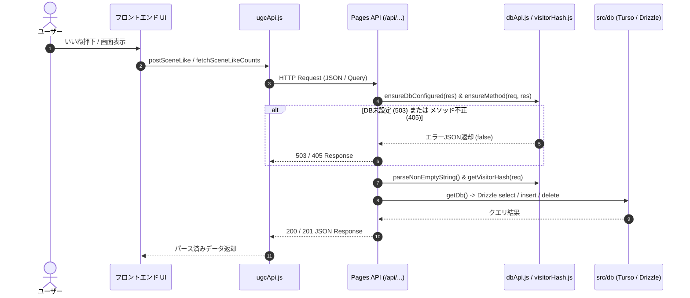

# DB・Turso バックエンド API アーキテクチャ仕様書

## 1. 全体アーキテクチャとレイヤー境界

フロントエンド（React コンポーネント）は `src/db/*` を直接参照せず、必ずクライアントラッパ（`src/libs/api/ugcApi.js`）経由で Next.js Pages API（`src/pages/api/*`）と通信します。

```mermaid
graph TD
    subgraph ClientScope["【フロントエンド層】React コンポーネント / Context"]
        LikeUI["EmakiLikeIcon / SceneLikeCountsContext / useMotifLike"]
        FeedbackUI["ScrollFeedbackPanel"]
        UgcClient["src/libs/api/ugcApi.js<br/>(requestJson / getJson / postJson)"]

        LikeUI --> UgcClient
        FeedbackUI --> UgcClient
    end

    UgcClient -->|HTTP GET / POST (JSON)| ApiLayer

    subgraph ApiLayer["【サーバー API 層】src/pages/api/"]
        SceneApi["likes/scene.js<br/>(GET集計 / POST登録・解除)"]
        EmakiApi["likes/emaki.js<br/>(POST冪等登録)"]
        FeedbackApi["feedback/scroll.js<br/>(POST読後フィードバック)"]
        DbHelper["src/libs/api/dbApi.js<br/>(ensureDbConfigured / ensureMethod / parseNonEmptyString / sendApiError)"]
        VisitorHelper["src/libs/api/visitorHash.js<br/>(匿名訪問者ハッシュ生成)"]

        SceneApi --> DbHelper
        SceneApi --> VisitorHelper
        EmakiApi --> DbHelper
        EmakiApi --> VisitorHelper
        FeedbackApi --> DbHelper
        FeedbackApi --> VisitorHelper
    end

    SceneApi --> DbCore
    EmakiApi --> DbCore
    FeedbackApi --> DbCore

    subgraph DbCore["【DB 接続・スキーマ層】src/db/"]
        DbIndex["src/db/index.js<br/>(@libsql/client + Drizzle シングルトン getDb / isDbConfigured)"]
        DbSchema["src/db/schema.js<br/>(emaki_likes / scene_likes / scroll_feedback)"]

        DbIndex --> DbSchema
    end
```

## 2. モジュール責務一覧

| レイヤー | ファイルパス | 主要責務 | 備考 |
|---------|-------------|---------|------|
| DB 接続 | `src/db/index.js` | ・TURSO_DATABASE_URL / TURSO_AUTH_TOKEN による libSQL クライアント生成<br>・Drizzle ORM シングルトン `getDb()` と設定確認 `isDbConfigured()` の提供 | React 側からの直接 import 禁止 |
| DB スキーマ | `src/db/schema.js` | ・SQLite/Turso テーブル定義とユニークインデックス管理<br>・drizzle-kit（`npm run db:push`）の正本スキーマ | ランタイムでの CREATE TABLE は行わない |
| API 共通基盤 | `src/libs/api/dbApi.js` | ・DB未設定ガード（`ensureDbConfigured` → 503）<br>・HTTPメソッド検証（`ensureMethod` → 405）<br>・文字列バリデーション（`parseNonEmptyString`）と統一エラー返却（`sendApiError`） | 全 DB 系 API ルートで共通利用 |
| 訪問者識別 | `src/libs/api/visitorHash.js` | ・リクエストヘッダ等から匿名ハッシュ（visitorHash）を生成し、ログイン不要での重複防止を実現 | `emaki_likes` / `scene_likes` のユニーク制約と連動 |
| クライアント通信 | `src/libs/api/ugcApi.js` | ・`requestJson` による統一 fetch ラッパ<br>・いいね系 API（503許容・楽観更新用）とフィードバック API の呼び出し関数群 | 今後コラボボード API クライアントもここへ集約 |

## 3. 標準データフロー（シーケンス図）



## 4. 変更履歴（リファクタリング記録）

- **API 共通ヘルパー集約 (`dbApi.js`)**: `sendApiError` と `parseNonEmptyString` を追加し、`ensureMethod` を配列指定対応に拡張。
- **いいね API 整理 (`likes/scene.js`, `likes/emaki.js`)**: メソッド別ハンドラ分離（`handleGet` / `handlePost`）と共通バリデーションへの置換を実施（レスポンス形式・ステータスコードは変更なし）。
- **クライアント通信統合 (`ugcApi.js`)**: `requestJson` 基盤に統合し、セクション区切りコメントを整備。