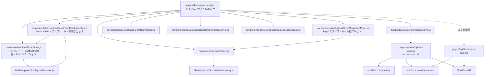
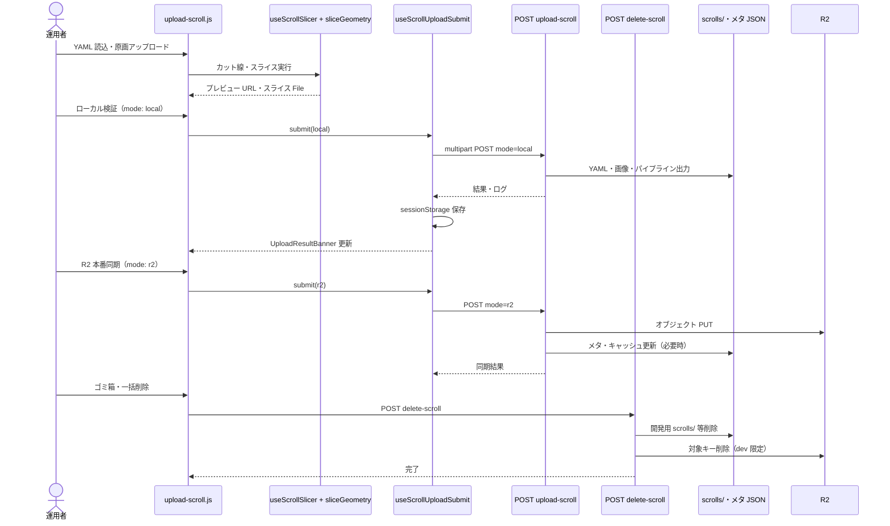
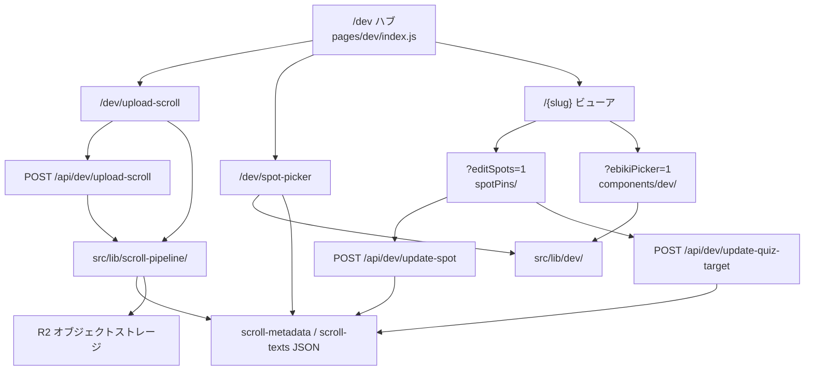

# 開発ツール統合仕様（`/dev` 集約）

## 概要

絵巻本番ビューア（`src/pages/[slug].js`）とは分離し、**メタデータ整備・座標編集・R2 アップロード**などの作業用 UI を `NODE_ENV === "development"` のときだけ使えるように集約する。

| レイヤ | 配置方針 |
|--------|----------|
| ビューア上オーバーレイ（スポットピン・編集モード） | `src/components/emaki/viewer/spotPins/` に維持（本番コードパスと同居、クエリで ON） |
| 開発ハブ・独立画面 | `src/pages/dev/*` |
| 開発専用 React 部品 | `src/components/dev/` |
| 開発専用ロジック・定数 | `src/lib/dev/`（本書）および関連 `src/lib/scroll-pipeline/` |
| 開発専用 API | `src/pages/api/dev/*` |

各 `src/pages/dev/*` は `getServerSideProps` で `NODE_ENV !== "development"` 時に `notFound: true` を返し、本番デプロイではルート自体を露出しない。

---

## ツール・URL・責務一覧

| URL / 契約 | 実装（主） | 責務 |
|------------|------------|------|
| `/dev` | `src/pages/dev/index.js` | 開発ツールハブ。共有スラッグ入力、各ツールへの導線、`noindex` |
| `/dev/upload-scroll` | `src/pages/dev/upload-scroll.js` + `src/lib/dev/uploadScroll/*` + `src/hooks/dev/*` + `src/components/dev/uploadScroll/*` | YAML・スライス・ローカル検証・R2 同期 UI（責務分離後の構成は下記「`/dev/upload-scroll` アーキテクチャ」） |
| `/dev/spot-picker` | `src/pages/dev/spot-picker.js` | CSV ベースのスポット座標ピッカー（旧スタンドアロン HTML の Next 移植） |
| `/{slug}?editSpots=1` | ビューア + `spotPins/` + dev API | ビューア上でスポット・クイズ枠をドラッグ編集し、開発 API 経由で JSON 更新 |
| `/{slug}?ebikiPicker=1` | ビューア + `src/components/dev/`（Ebiki ピッカー） | 絵引エリア座標の取得・調整 |
| `POST /api/dev/upload-scroll` | `src/pages/api/dev/upload-scroll.js` | `mode: "local" \| "r2"` — ローカル `scrolls/` 書込または R2 本番同期（development 限定） |
| `POST /api/dev/delete-scroll` | `src/pages/api/dev/delete-scroll.js` | 開発環境専用の絵巻アセット一括削除（ローカル／R2） |
| `POST /api/dev/update-spot` | `src/pages/api/dev/update-spot.js` | スポット座標・メタのファイル更新 |
| `POST /api/dev/update-quiz-target` | `src/pages/api/dev/update-quiz-target.js` | クイズ枠座標のファイル更新 |

**ストレージ（参照先の例）:** `src/data/scroll-metadata/`, `src/data/scroll-texts/`, ローカル `scrolls/{titleen}/`, Cloudflare R2（画像）。パイプライン詳細は `src/lib/scroll-pipeline/SPEC.md`。

---

## `/dev/upload-scroll` アーキテクチャ（責務分離後）

### ファイル構成・責務一覧

| パス | 責務 |
|------|------|
| `src/pages/dev/upload-scroll.js` | メインコンテナ。開発 SSR ガード、`useScrollFormState` / `useScrollSlicer` / `useScrollUploadSubmit` の配線、子セクション UI オーケストレーション |
| `src/lib/dev/uploadScroll/sliceGeometry.js` | 画像・`File` 変換、スライス座標計算、Canvas による JPEG スライス生成 |
| `src/lib/dev/uploadScroll/yamlValidator.js` | `scroll_config.yaml` バリデーション、メタ抽出、検証用定数 |
| `src/hooks/dev/useScrollFormState.js` | テンプレート読込・YAML/画像 D&D 状態・リアルタイムバリデーション |
| `src/hooks/dev/useScrollSlicer.js` | スライス状態、カット操作、プレビュー Object URL の生成・解放 |
| `src/hooks/dev/useScrollUploadSubmit.js` | `sessionStorage` への結果永続化、`POST /api/dev/upload-scroll` 送信、実行ログ管理 |
| `src/components/dev/uploadScroll/YamlConfigSection.js` | Step 1: YAML エディタ・テンプレート選択・事前チェック表示 |
| `src/components/dev/uploadScroll/AutoSlicePanel.js` | Step 2: 長尺元画像スライス UI・カット線プレビュー操作 |
| `src/components/dev/uploadScroll/ThumbCard.js` | シーンサムネイルカード表示 |
| `src/components/dev/uploadScroll/UploadResultBanner.js` | ローカル／R2 実行結果・エラー表示 |
| `src/components/dev/uploadScroll/uploadScrollStyles.js` | アップロード画面専用スタイル定数 |
| `src/pages/api/dev/upload-scroll.js` | `mode: "local" \| "r2"` — ローカル先行検証（`scrolls/`・メタ）または R2 オブジェクト同期 |
| `src/pages/api/dev/delete-scroll.js` | 開発環境限定の一括削除（ローカル成果物・関連 R2 キー） |

### モジュール依存（Mermaid）

### データフロー：ローカル検証 → R2 本番同期 → ゴミ箱削除

---

## 依存関係（Mermaid）

---

## レガシー移行・整理済み

| 項目 | 移行前 | 移行後 |
|------|--------|--------|
| 絵引座標ピッカー | ビューア配下に散在していた `EbikiCoordinatePicker.jsx` | `src/components/dev/` に集約し、`?ebikiPicker=1` でビューアから起動 |
| CSV スポットピッカー | `tools/spot_picker.html`（スタンドアロン） | `src/pages/dev/spot-picker.js`（`/dev/spot-picker`）。ハブからリンク |
| 開発ツール入口 | 個別 URL・HTML の直リンク | `/dev` ハブ（`src/pages/dev/index.js`）に一元化 |

**残置参考:** `tools/spot_picker.html` は移行期の参照用として残る場合があるが、運用の正本は `/dev/spot-picker` とする。

---

## 追加・変更時のチェックリスト

1. 新規画面は `src/pages/dev/` + development 限定 `getServerSideProps`。
2. 本番ビューアに載せるオーバーレイのみ `spotPins/` または既存ビューアツリーに置き、ON/OFF はクエリパラメータで契約化。
3. ファイル書き込みは `src/pages/api/dev/*` に集約し、クライアントから直接 FS を触らない。
4. ハブ（`/dev`）にカードと URL を 1 行で追記し、本 SPEC の表を同期する。