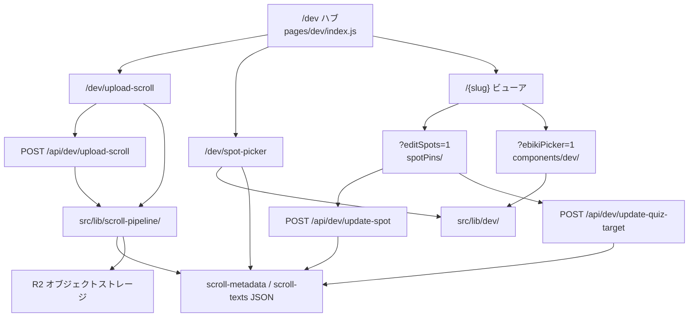

# 開発ツール統合仕様（`/dev` 集約）

## 概要

絵巻本番ビューア（`src/pages/[slug].js`）とは分離し、**メタデータ整備・座標編集・R2 アップロード**などの作業用 UI を `NODE_ENV === "development"` のときだけ使えるように集約する。

| レイヤ | 配置方針 |
|--------|----------|
| ビューア上オーバーレイ（スポットピン・編集モード） | `src/components/emaki/viewer/spotPins/` に維持（本番コードパスと同居、クエリで ON） |
| 開発ハブ・独立画面 | `src/pages/dev/*` |
| 開発専用 React 部品 | `src/components/dev/` |
| 開発専用ロジック・定数 | `src/lib/dev/`（本書）および関連 `src/lib/scroll-pipeline/` |
| 開発専用 API | `src/pages/api/dev/*` |

各 `src/pages/dev/*` は `getServerSideProps` で `NODE_ENV !== "development"` 時に `notFound: true` を返し、本番デプロイではルート自体を露出しない。

---

## ツール・URL・責務一覧

| URL / 契約 | 実装（主） | 責務 |
|------------|------------|------|
| `/dev` | `src/pages/dev/index.js` | 開発ツールハブ。共有スラッグ入力、各ツールへの導線、`noindex` |
| `/dev/upload-scroll` | `src/pages/dev/upload-scroll.js` | YAML・シーン・画像から scroll メタ生成、パイプライン実行、R2 アップロード UI |
| `/dev/spot-picker` | `src/pages/dev/spot-picker.js` | CSV ベースのスポット座標ピッカー（旧スタンドアロン HTML の Next 移植） |
| `/{slug}?editSpots=1` | ビューア + `spotPins/` + dev API | ビューア上でスポット・クイズ枠をドラッグ編集し、開発 API 経由で JSON 更新 |
| `/{slug}?ebikiPicker=1` | ビューア + `src/components/dev/`（Ebiki ピッカー） | 絵引エリア座標の取得・調整 |
| `POST /api/dev/upload-scroll` | `src/pages/api/dev/upload-scroll.js` | アップロード・パイプライン用サーバ処理（development 限定） |
| `POST /api/dev/update-spot` | `src/pages/api/dev/update-spot.js` | スポット座標・メタのファイル更新 |
| `POST /api/dev/update-quiz-target` | `src/pages/api/dev/update-quiz-target.js` | クイズ枠座標のファイル更新 |

**ストレージ（参照先の例）:** `src/data/scroll-metadata/`, `src/data/scroll-texts/`, Cloudflare R2（画像）。パイプライン詳細は `src/lib/scroll-pipeline/SPEC.md`。

---

## 依存関係（Mermaid）

---

## レガシー移行・整理済み

| 項目 | 移行前 | 移行後 |
|------|--------|--------|
| 絵引座標ピッカー | ビューア配下に散在していた `EbikiCoordinatePicker.jsx` | `src/components/dev/` に集約し、`?ebikiPicker=1` でビューアから起動 |
| CSV スポットピッカー | `tools/spot_picker.html`（スタンドアロン） | `src/pages/dev/spot-picker.js`（`/dev/spot-picker`）。ハブからリンク |
| 開発ツール入口 | 個別 URL・HTML の直リンク | `/dev` ハブ（`src/pages/dev/index.js`）に一元化 |

**残置参考:** `tools/spot_picker.html` は移行期の参照用として残る場合があるが、運用の正本は `/dev/spot-picker` とする。

---

## 追加・変更時のチェックリスト

1. 新規画面は `src/pages/dev/` + development 限定 `getServerSideProps`。
2. 本番ビューアに載せるオーバーレイのみ `spotPins/` または既存ビューアツリーに置き、ON/OFF はクエリパラメータで契約化。
3. ファイル書き込みは `src/pages/api/dev/*` に集約し、クライアントから直接 FS を触らない。
4. ハブ（`/dev`）にカードと URL を 1 行で追記し、本 SPEC の表を同期する。