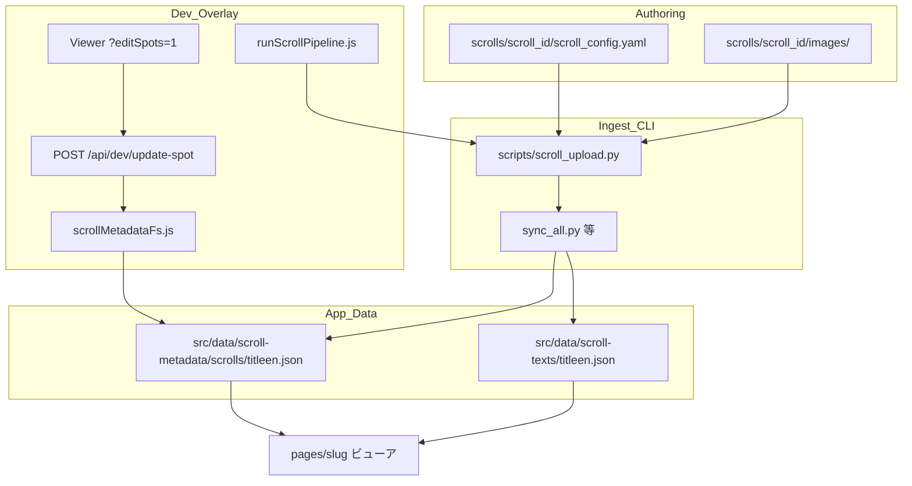
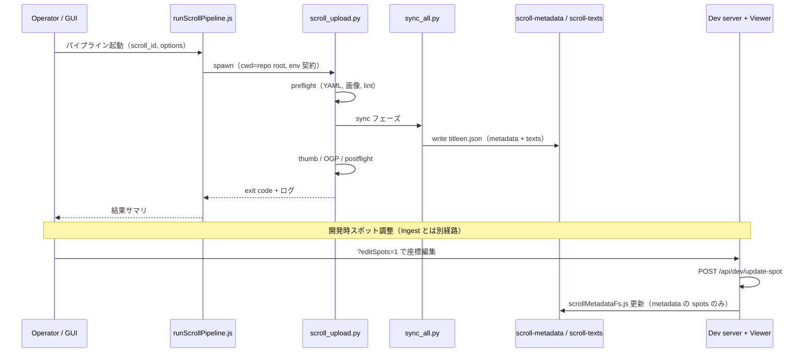

# Scroll Pipeline — Architecture & Contracts

作品データの登録・同期パイプライン層。Authoring / Ingest / Dev Overlay の責務を分離し、本番 JSON と開発時のスポット微調整を一貫した契約でつなぐ。

---

## 1. アーキテクチャ概要

| レイヤ | 正本・入口 | 出力・副作用 |
|--------|------------|--------------|
| **Authoring（入力正本）** | `scrolls/{scroll_id}/scroll_config.yaml` + `scrolls/{scroll_id}/images/` | 人手・スキルが編集する唯一のソース。`scroll_id` ≠ `titleen` の場合は YAML で対応 |
| **Ingest（同期パイプライン）** | CLI: `scripts/scroll_upload.py`（オーケストレーション）→ 内部で `sync_all.py` 等 | `src/data/scroll-metadata/scrolls/{titleen}.json`（画像・シーン・スポット等） `src/data/scroll-texts/{titleen}.json`（解説テキスト） 必要に応じ thumb / OGP / cache 更新 |
| **Dev Overlay（開発時微調整）** | ビューア `?editSpots=1` → UI から `POST /api/dev/update-spot` | `scrollMetadataFs.js` 経由で metadata JSON のスポット座標をローカル FS に書き戻し（本番 Authoring には自動反映しない） |

**原則**

- 本番データの正本は Ingest 後の `src/data/scroll-metadata/` と `src/data/scroll-texts/`。
- `scrolls/` は gitignore されるローカル Authoring 領域（skill: scroll-upload 参照）。
- Dev Overlay は開発専用。恒久変更は YAML / 再 sync に戻す。

---

## 2. ファイル構成と責務

### 2.1 `src/lib/scroll-pipeline/`（本ディレクトリ）

| ファイル | 責務 |
|----------|------|
| `scrollMetadataFs.js` | scroll metadata JSON の読み書き（パス解決、`titleen` 単位）。Dev API からのスポット更新の FS 境界 |
| `runScrollPipeline.js` | 開発サーバー／GUI から Ingest を起動する薄いラッパ（`scroll_upload.py` 等への引数・cwd 契約） |
| `SPEC.md` | パイプライン層の構成・データフロー・CLI 契約（本書） |

### 2.2 関連（パイプライン外だが契約上接続）

| ファイル | 責務 |
|----------|------|
| `src/pages/api/dev/update-spot.js` | `?editSpots=1` からの POST 受け口。検証後 `scrollMetadataFs.js` でスポットを永続化 |
| `scripts/scroll_upload.py` | preflight → sync → thumb/OGP → postflight の一発オーケストレーション CLI |
| `scripts/sync_all.py`（および配下） | YAML / 画像 → `scroll-metadata`・`scroll-texts` JSON 生成の中核 |

---

## 3. モジュール依存関係（Mermaid）

---

## 4. GUI 一発アップロード＆同期フロー（予定・sequenceDiagram）

---

## 5. 既存 CLI との契約（簡潔）

| 項目 | 契約 |
|------|------|
| エントリ | `python scripts/scroll_upload.py`（引数は skill `scroll-upload` / `docs/operations/cursor-scroll-sync-prompt.md` に準拠） |
| 入力 | `scrolls/{scroll_id}/` 配下の `scroll_config.yaml` と `images/` |
| 出力 | `src/data/scroll-metadata/scrolls/{titleen}.json`、`src/data/scroll-texts/{titleen}.json`（`titleen` は YAML 定義） |
| 失敗時 | 非ゼロ終了。preflight 失敗時は JSON を書かない／部分書き込みを避ける |
| `runScrollPipeline.js` | 上記 CLI を子プロセス実行。stdio は呼び出し元に渡す。パスはリポジトリルート基準 |
| Dev API | 本番ビルドでは無効化または到達不能とする。metadata の spots フィールドのみ更新可 |

---

## 6. データ識別子

| 名前 | 用途 |
|------|------|
| `scroll_id` | `scrolls/` ディレクトリ名・Authoring キー |
| `titleen` | 公開 slug / JSON ファイル名・URL セグメント（`docs/operations/data-model.md` 参照） |

Ingest は Authoring の `scroll_id` を読み、出力は常に `titleen` 名の JSON とする。