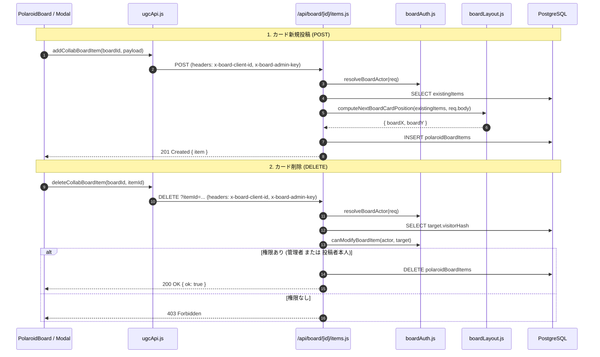

# Polaroid Board & UGC API Specification (`src/libs/api` & `src/pages/api/board`)

## 1. アーキテクチャ構成（モジュール依存関係）

クライアント側のAPIラッパー（`ugcApi.js`）、APIルートコントローラ（`pages/api/board/*`）、および共通ドメインロジック（`boardAuth.js` / `boardLayout.js`）の責務を分離し、認証不整合や座標計算の重複を防止する。

```mermaid
graph TD
  UI[PolaroidBoardView / PolaroidModalFooter] --> UGC[src/libs/api/ugcApi.js]
  UGC -->|x-board-client-id / x-board-admin-key| API_BOARDS[pages/api/board/index.js]
  UGC -->|x-board-client-id / x-board-admin-key| API_BOARD[pages/api/board/[id]/index.js]
  UGC -->|x-board-client-id / x-board-admin-key| API_ITEMS[pages/api/board/[id]/items.js]

  API_ITEMS --> AUTH[src/libs/api/boardAuth.js]
  API_ITEMS --> LAYOUT[src/libs/api/boardLayout.js]
  API_BOARD --> AUTH
  API_BOARDS --> AUTH

  AUTH --> HASH[src/libs/api/visitorHash.js]
  API_ITEMS --> DB[(PostgreSQL / Drizzle)]
  API_BOARD --> DB
  API_BOARDS --> DB
```

## 2. ファイル別責務一覧

| ファイルパス | 区分 | 主な責務・エクスポート |
|-------------|------|------------------------|
| `src/libs/api/boardAuth.js` | Server Pure Logic | `resolveBoardActor(req)` / `canModifyBoardItem(actor, item)`。環境変数 `NEXT_PUBLIC_BOARD_ADMIN_KEY` とリクエストヘッダーから管理者・投稿者本人を一元判定する。 |
| `src/libs/api/boardLayout.js` | Server Pure Logic | `computeNextBoardCardPosition(existingItems, requested)`。既存カードがある場合は最右端カードの隣（+265px）に配置し、0枚時は初期原点（-260, -160）を返す。 |
| `src/libs/api/visitorHash.js` | Server Utility | `getVisitorHash(req)`。IPアドレス等から匿名ビジター識別ハッシュを生成する。 |
| `src/libs/api/ugcApi.js` | Client API Client | `buildBoardAuthHeaders()` により全ボード系リクエストへ `x-board-client-id` と `x-board-admin-key` を自動付与し、CRUD・いいねAPIを提供する。 |
| `src/pages/api/board/index.js` | API Endpoint | 公開コラボボード一覧の取得（GET）および新規作成（POST）。 |
| `src/pages/api/board/[id]/index.js` | API Endpoint | 個別コラボボードのメタデータ・カード一覧取得（GET）、タイトル・お題・関連ハブ更新（PATCH）、ボード削除（DELETE）。 |
| `src/pages/api/board/[id]/items.js` | API Endpoint | ポラロイドカードの投稿（POST）、座標・重なり順・メモ・いいね更新（PATCH）、削除（DELETE）を行う薄型コントローラ。 |

## 3. 認証・権限判定仕様（重要・再発防止ルール）

### 3.1 環境変数名の統一

管理者キーの環境変数名はフロントエンド・APIルート全体で `NEXT_PUBLIC_BOARD_ADMIN_KEY` に統一する。APIルート内で `process.env.BOARD_ADMIN_KEY` を個別に参照してはならない（キー不一致による 403 Forbidden 再発防止のため、必ず `boardAuth.js` の `resolveBoardActor(req)` を経由すること）。

### 3.2 リクエストヘッダーと識別子

**クライアント送信ヘッダー**（`ugcApi.js` の `buildBoardAuthHeaders` で自動付与）：

- `x-board-client-id`: `localStorage["emakimono_polaroid_client_id_v1"]` のブラウザ固有ID
- `x-board-admin-key`: `localStorage["emakimono_board_admin_key"]` の管理者キー（開発環境・管理者モード時）

**DB保存形式**（`polaroidBoardItems.visitorHash`）：

- `clientId` あり: `${visitorHash}:${clientId}`（最大64文字）
- `clientId` なし: `${visitorHash}`

**変更・削除権限判定**（`canModifyBoardItem(actor, item)`）：

- `actor.isBoardAdmin === true`（管理者キー一致）なら無条件で許可
- `item.visitorHash === actor.visitorHash` なら投稿者本人として許可
- `item.visitorHash === actor.clientId` または `item.visitorHash.endsWith(\`:${actor.clientId}\`)` なら同一ブラウザの投稿者本人として許可

## 4. カード投稿・更新・削除データフロー



## 5. 保守・変更時のチェックリスト

- **新規エンドポイント／メソッド追加時:** 必ず `resolveBoardActor(req)` と `canModifyBoardItem(actor, item)` を使用し、独自のヘッダー読み取りや環境変数参照を書かない。
- **フロントエンドAPI追加時:** `ugcApi.js` 内で `buildBoardAuthHeaders()` を通してリクエストを送信する。
- **検証完了後のデバッグログ停止:** `usePolaroidBoardSync.js` の `DEBUG_BOARD_PERSIST` は本番マージ前に必ず `false` に戻す。