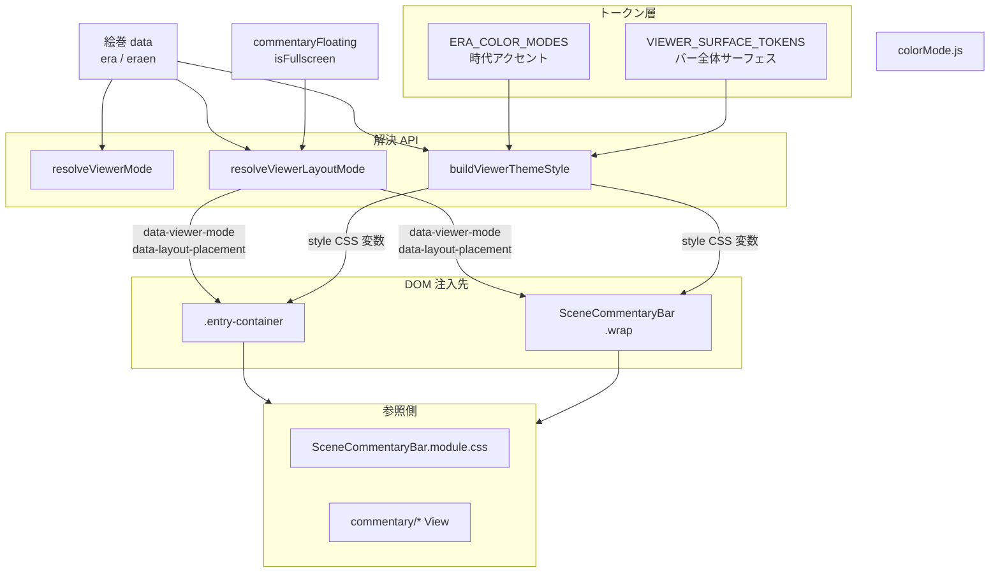

# カラーモード基盤（`src/theme/colorMode.js`）

## 統合設計図

全体サーフェス（クリーム基調のバー UI）× 時代カラー（`ERA_COLOR_MODES`）× レイアウトモード（`emaki` / `byobu` × `inline` / `floating`）を `colorMode.js` で一元管理する。

### レイアウトモード行列

| | `inline` | `floating` |
|---|----------|------------|
| **emaki** | 通常縦画面・バーはビューア下部に Inline | md+ 横画面 / フルスクリーン時カード浮遊 |
| **byobu** | 同上（屏風スポット解説） | 同上 |

`resolveViewerLayoutMode({ data, commentaryFloating, isFullscreen })` が `layoutPlacement` を決定する。`commentaryFloating || isFullscreen` のとき `floating`。

## 時代トークン一覧

| モードキー | badgeBg（後方互換） | accent | text | 用途 |
|------------|---------------------|--------|------|------|
| `heian` | `#ff8c77` | `#ff8c77` | `#c8523b` | 平安 |
| `kamakura` | `#54896a` | `#54896a` | `#3d6b50` | 鎌倉 |
| `muromachi` | `purple` | `#7e57c2` | `#5e35b1` | 室町 |
| `azuchimomoyama` | `gold` | `#c69214` | `#9a6f08` | 安土・桃山 |
| `edo` | `skyblue` | `#3b82b6` | `#256394` | 江戸 |
| `meiji` | `firebrick` | `#b23a3a` | `#8f2828` | 明治 |
| `default` | — | `#8a6d3b` | `#6e552b` | 未定義時代 |

## 全体サーフェストークン（`VIEWER_SURFACE_TOKENS`）

| キー | 値 |
|------|-----|
| `barBg` | `rgba(255, 252, 246, 0.92)` |
| `barSurfaceSolid` | `#fff` |
| `barSubtleBg` | `#f0ece6` |
| `barBorder` | `rgba(0, 0, 0, 0.12)` |
| `barDivider` | `rgba(0, 0, 0, 0.08)` |
| `barShadow` | `0 6px 24px rgba(0, 0, 0, 0.12)` |
| `barText` | `rgb(20, 20, 20)` |
| `barTextMuted` | `#6b7280` |

## CSS 変数契約（全一覧）

`buildViewerThemeStyle(data)` が `.entry-container` およびコメンタリーバー `.wrap` に注入する変数:

### 時代カラー（`--era-*` / レガシー同期）

| 変数 | ソーストークン | 主な利用 |
|------|----------------|----------|
| `--era-accent` | `accent` | タブ・アクティブ枠・ピル |
| `--era-text` | `text` | 段タイトル・テキストリンク |
| `--era-soft-bg` | `softBg` | 選択・ホバー背景 |
| `--era-border` | `border` | 強調ボーダー |
| `--accent-color` | `accent` | レガシー参照（探索 UI 等） |
| `--clr-link` | `text` | リンク色（時代テキスト色に同期） |

### 全体サーフェス（`--bar-*`）

| 変数 | ソーストークン | 主な利用 |
|------|----------------|----------|
| `--bar-bg` | `barBg` | バー和紙調背景 |
| `--bar-surface-solid` | `barSurfaceSolid` | 再表示ボタン等の白面 |
| `--bar-subtle-bg` | `barSubtleBg` | サムネイルプレースホルダ |
| `--bar-border` | `barBorder` | ピル・カード枠 |
| `--bar-divider` | `barDivider` | 区切り・非アクティブドット |
| `--bar-shadow` | `barShadow` | フローティングカード影（予約） |
| `--bar-text` | `barText` | 本文・探索 UI テキスト |
| `--bar-text-muted` | `barTextMuted` | 補足・メタ・PR バッジ |

CSS / コンポーネントでは必ず `var(--token, 従来値)` 形式でフォールバックを付ける。

## ビューア DOM 属性

| 属性 | 値 | 設定箇所 |
|------|-----|----------|
| `data-viewer-mode` | `"emaki"` \| `"byobu"` | `EmakiConteiner` `.entry-container`, `SceneCommentaryBar` `.wrap` |
| `data-layout-placement` | `"inline"` \| `"floating"` | 同上 |

## API

- `resolveEraModeKey(eraOrEraEn)` — 表示名・英語名・スラッグ → モードキー
- `getEraColorTokens(eraOrEraEn)` — 時代トークンオブジェクト
- `resolveViewerMode(data)` — `isByobuScroll(data)` によるモード
- `resolveViewerLayoutMode({ data, commentaryFloating, isFullscreen })` — ビューア＋配置モード
- `buildViewerThemeStyle(data, options?)` — React `style` 用 CSS 変数（時代＋サーフェス）
- `VIEWER_SURFACE_TOKENS` — 全体サーフェス定数（参照・テスト用）

`eraColor()`（`src/utils/emakiEra.js`）は `getEraColorTokens(x).badgeBg` の薄いラッパー。