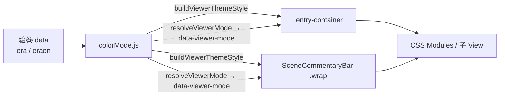

# カラーモード基盤（`src/theme/colorMode.js`）

## 構成

## 時代トークン一覧

| モードキー | badgeBg（後方互換） | accent | text | 用途 |
|------------|---------------------|--------|------|------|
| `heian` | `#ff8c77` | `#ff8c77` | `#c8523b` | 平安 |
| `kamakura` | `#54896a` | `#54896a` | `#3d6b50` | 鎌倉 |
| `muromachi` | `purple` | `#7e57c2` | `#5e35b1` | 室町 |
| `azuchimomoyama` | `gold` | `#c69214` | `#9a6f08` | 安土・桃山 |
| `edo` | `skyblue` | `#3b82b6` | `#256394` | 江戸 |
| `meiji` | `firebrick` | `#b23a3a` | `#8f2828` | 明治 |
| `default` | — | `#8a6d3b` | `#6e552b` | 未定義時代 |

## CSS 変数契約

`buildViewerThemeStyle(data)` が `.entry-container` およびコメンタリーバー `.wrap` に注入する変数:

| 変数 | ソーストークン | 主な利用 |
|------|----------------|----------|
| `--era-accent` | `accent` | タブ・アクティブ枠・ピル |
| `--era-text` | `text` | 段タイトル・テキストリンク |
| `--era-soft-bg` | `softBg` | 選択・ホバー背景 |
| `--era-border` | `border` | 強調ボーダー |
| `--accent-color` | `accent` | レガシー参照（探索 UI 等） |
| `--clr-link` | `text` | リンク色（時代テキスト色に同期） |

## ビューアモード属性

| 属性 | 値 | 設定箇所 |
|------|-----|----------|
| `data-viewer-mode` | `"emaki"` \| `"byobu"` | `EmakiConteiner` `.entry-container`, `SceneCommentaryBar` `.wrap` |

## API

- `resolveEraModeKey(eraOrEraEn)` — 表示名・英語名・スラッグ → モードキー
- `getEraColorTokens(eraOrEraEn)` — トークンオブジェクト
- `resolveViewerMode(data)` — `isByobuScroll(data)` によるモード
- `buildViewerThemeStyle(data)` — React `style` 用 CSS 変数

`eraColor()`（`src/utils/emakiEra.js`）は `getEraColorTokens(x).badgeBg` の薄いラッパー。